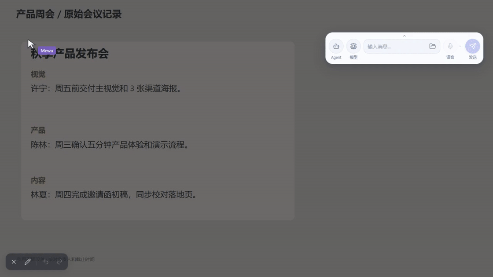
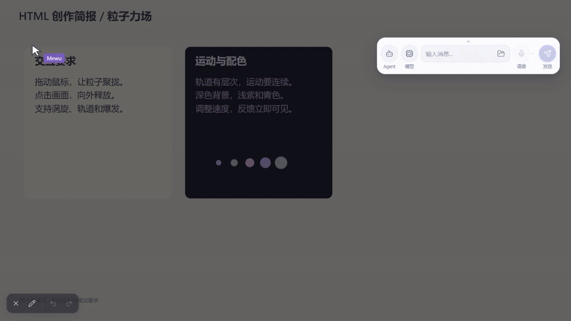
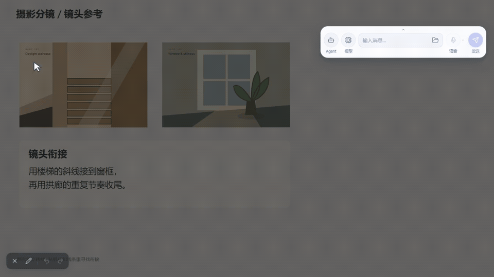
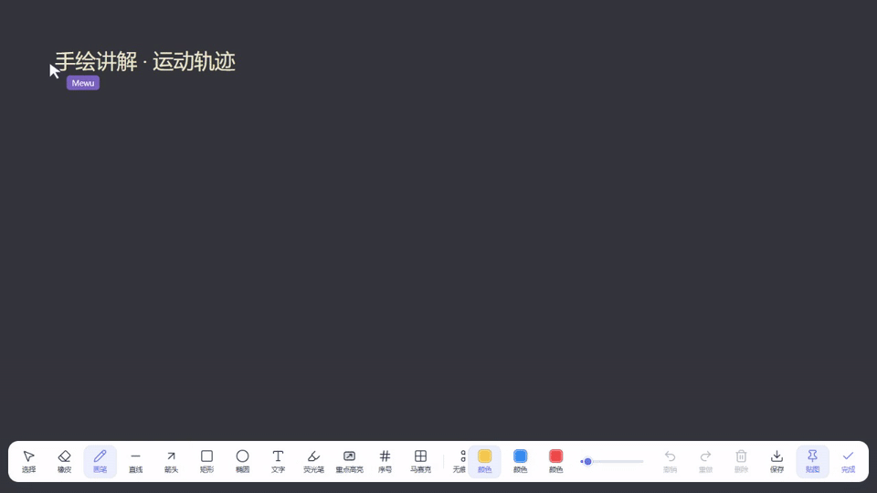
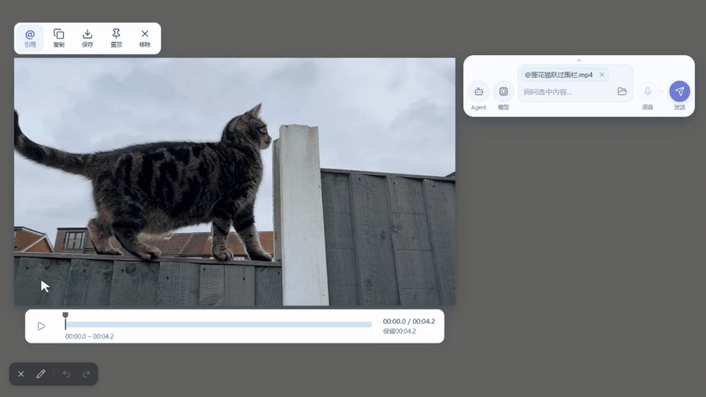
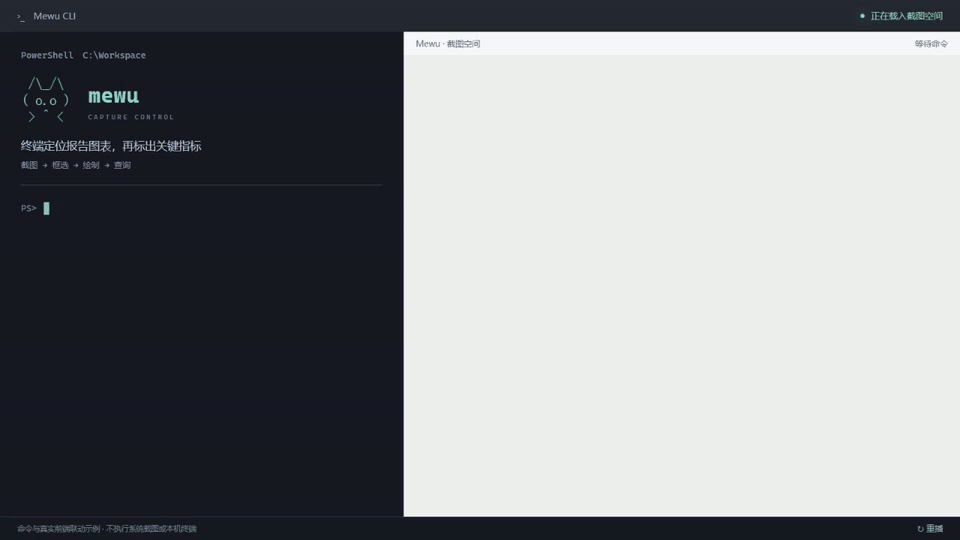
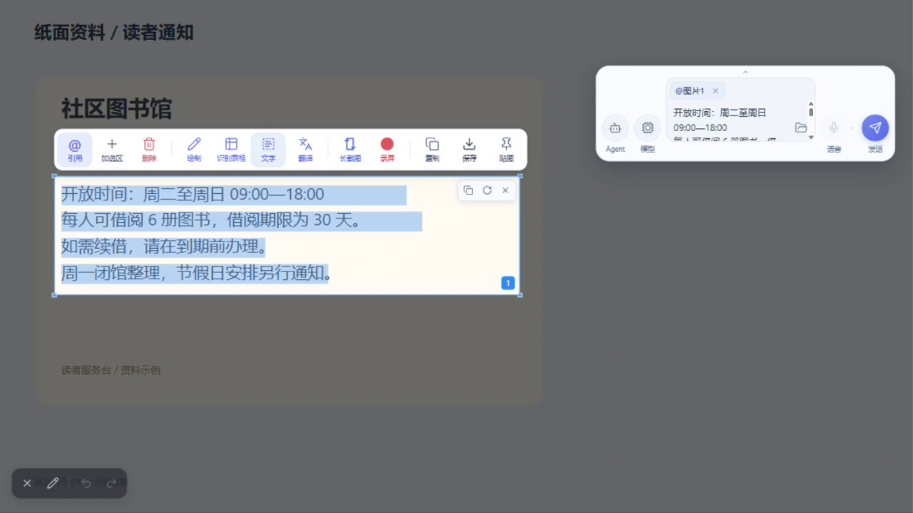
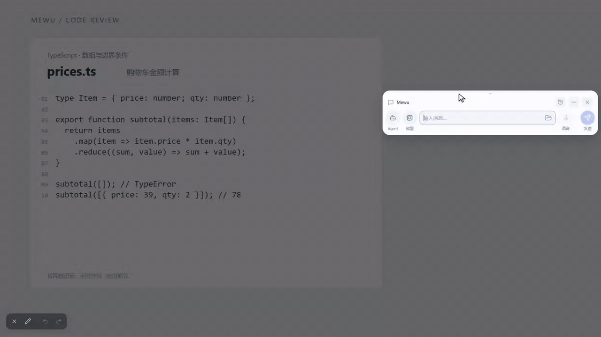
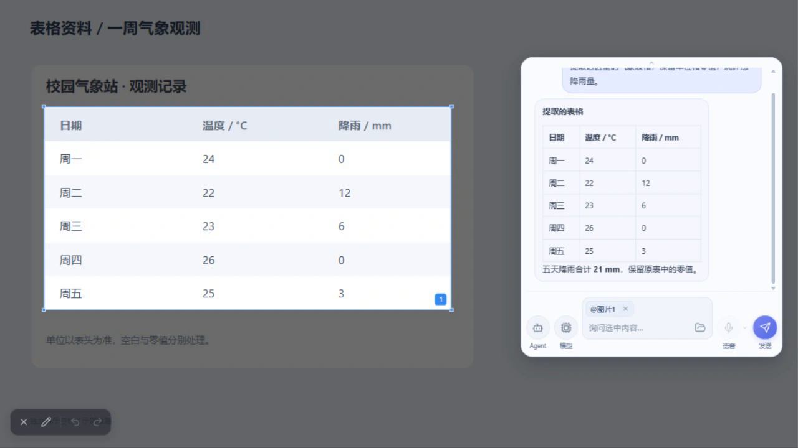
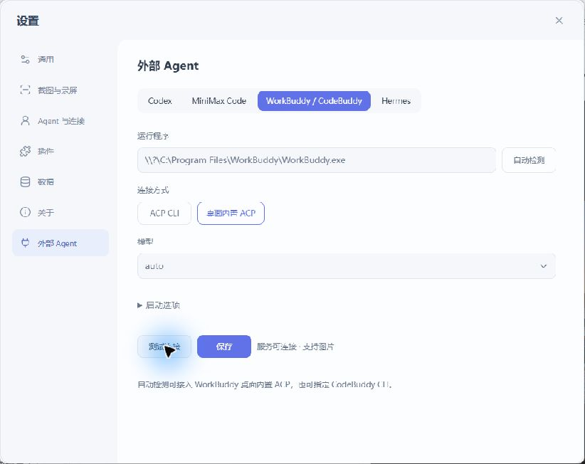

<div align="center">
  
  <h1>MewuAI — Personal Agent &amp; AI Creative Canvas</h1>
  <p>An open-source, LLM-powered desktop app for conversation, visual annotation, creative tools, and desktop actions.</p>
  <p>
    <a href="https://github.com/abnste/mewu_ai/releases/latest"></a>
    
    
    
    <a href="./LICENSE"></a>
  </p>
  <p><a href="https://www.mewu.ai/download.php?platform=windows"><strong>Windows installer</strong></a> &nbsp;·&nbsp; <a href="https://www.mewu.ai/download.php?platform=portable"><strong>Windows portable</strong></a> &nbsp;·&nbsp; <a href="https://www.mewu.ai/download.php?platform=macos"><strong>macOS ARM64</strong></a> &nbsp;·&nbsp; <a href="https://www.mewu.ai/download.php?platform=linux"><strong>Linux x64</strong></a></p>
  <p><a href="./README.zh-CN.md">简体中文</a> · <strong>English</strong> · <a href="https://www.mewu.ai/?lang=en">Website</a> · <a href="https://github.com/abnste/mewu_ai/releases/latest">Release notes</a> · <a href="https://github.com/abnste/mewu_ai/issues">Report an issue</a></p>
</div>

**MewuAI is an open-source desktop Agent app for Windows, macOS, and Linux.** Select screen content and express what you need through annotations, freehand drawings, and files. Chat, organize references, generate interactive tools, and use plugins to act in the same space. **Mewu with you** — working alongside you.

| At a glance | Details |
| --- | --- |
| Platforms | Windows x64, macOS ARM64, Linux x64; Simplified Chinese and English UI |
| Core capabilities | Personal Agent, AI creative canvas, visual annotation, interactive HTML, CLI, and plugins |
| Workflow | Select to reference → describe the task → use, annotate, or refine the result |
| Local tools | Capture, manual drawing, pinning, local OCR, and recording need no AI account |
| AI connections | Choose model services, external Agents, MCP tools, and independent memory providers |
| Official sources | [Latest release](https://github.com/abnste/mewu_ai/releases/latest) · [Plugin marketplace](https://github.com/abnste/mewu-plugins) |

<p align="center">
  <a href="./docs/media/readme/agent-overview.gif"></a>
  <br /><sub>Select references, talk to an Agent, and use generated tools in the same workspace.</sub>
</p>

## Features

- **Personal Agent:** choose a role, model, tools, and memory. Reference images, videos, and files; retain conversation history; read Markdown, formulas, and collapsible public reasoning. Use the official Agent's persistent local memory or connect an independent memory service.
- **AI creative canvas:** arrange, resize, pin, or save images, videos, text, and generated objects. Describe an HTML / SVG / Canvas tool, use the resulting calculator, experiment, or game, and ask for further changes.
- **Capture and multiple selections:** capture a region, multiple areas, scrolling content, or supported windows. Selections automatically become references while the surrounding screen dims, with no separate “Reference” click.
- **Drawing and annotation:** pens, arrows, shapes, text, numbering, highlights, and mosaic, with undo, redo, and object editing. Add marks yourself or ask AI to explain and highlight specific details in worksheets, code, and other references.
- **Text and tables:** local OCR, capture translation, chart understanding, and table extraction. Windows/macOS also offer actionable recognition of links, emails, phone numbers, QR codes, and barcodes.
- **Recording and video annotation:** capture system audio and microphone input; pause, resume, trim, and export MP4 / MP3 / GIF. Add rectangles and text for time ranges, then click conversation timestamps to revisit them. Audio support varies by system.
- **Blackboard:** draw and explain on a full-screen board, combining questions, formulas, and AI analysis. A setting lets screen-sharing apps see selections and annotations.
- **CLI and region AI operations:** local Agents can inspect scenes, capture, add selections, draw, and export. The region plugin lets a model observe a selected target, act, and check a fresh screenshot before continuing.
- **Plugins and event triggers:** extend Agents, memory, tools, and UI independently. Official Hooks supports schedules, prompts, completed replies, global shortcuts, and app/plugin events, connecting Mewu operations, MCP, commands, and keyboard/mouse actions.
- **Skills and self-made plugins:** the built-in Agent can read portable `SKILL.md` skills, create and validate plugin projects, and prepare an installable package. Review permissions before installation under Installed → Self-made. Plugins can reorder the original screenshot toolbar through the [generic layout service](./docs/plugin-toolbar-layout.md). See [skills and authoring](./docs/agent-skills.md).

Capture, drawing, and recording work without AI setup. AI conversations, translation, and generated content require a configured service.

## In development / TODO

- Reference-guided generation and dedicated image/video model connections.
- Circle-to-search, a desktop companion plugin, and more desktop collaboration workflows.
- Broader platform coverage, language support, and performance improvements.

## Feature demos

<table>
<tr>
<td width="50%" valign="top">
<h3>Exam annotation</h3>
<p>Explain a worksheet and add construction lines, reasoning, and annotations to the original.</p>
<a href="./docs/images/exam-annotation-latest.jpg"></a>
</td>
<td width="50%" valign="top">
<h3>Generate HTML tools</h3>
<p>Describe a tool, generate interactive content, and keep using and refining it.</p>
<a href="./docs/media/readme/interactive-tools.gif"></a>
</td>
</tr>
<tr>
<td width="50%" valign="top">
<h3>AI creative canvas</h3>
<p>Arrange storyboards, images, and conversations to develop a creative project.</p>
<a href="./docs/media/readme/creative-canvas.gif"></a>
</td>
<td width="50%" valign="top">
<h3>Blackboard</h3>
<p>Draw axes, curves, and notes by hand to explain your reasoning.</p>
<a href="./docs/media/readme/blackboard.gif"></a>
</td>
</tr>
<tr>
<td width="50%" valign="top">
<h3>Video annotations</h3>
<p>Annotate time ranges, play the result, and click timestamps to revisit the relevant frames.</p>
<a href="./docs/media/readme/video-annotations.gif"></a>
</td>
<td width="50%" valign="top">
<h3>CLI capture and drawing</h3>
<p>Call capture, selection, and drawing operations from a terminal and see the results in Mewu.</p>
<a href="./docs/media/readme/cli-screen-control.gif"></a>
</td>
</tr>
<tr>
<td width="50%" valign="top">
<h3>Text recognition</h3>
<p>Extract the text you need from a capture using local OCR.</p>
<a href="./docs/media/readme/ocr.png"></a>
</td>
<td width="50%" valign="top">
<h3>Code explanation</h3>
<p>Select code, explain its logic, mark the failing line, and show a correction beside the original.</p>
<a href="./docs/media/readme/code-explanation.gif"></a>
</td>
</tr>
<tr>
<td width="50%" valign="top">
<h3>Table extraction</h3>
<p>Turn a captured table into structured data you can copy, compare, and use for further analysis.</p>
<a href="./docs/media/readme/table.png"></a>
</td>
<td width="50%" valign="top">
<h3>External Agents</h3>
<p>Connect Codex, MiniMax Code, WorkBuddy / CodeBuddy, or Hermes to the existing conversation bar.</p>
<a href="./docs/media/readme/external-agents.jpg"></a>
</td>
</tr>
</table>

<details>
<summary>About the demos</summary>

Animations use Mewu interface components with prepared example content; generated results vary by model and prompt. Video annotations appear over assigned time ranges and do not imply automatic object tracking. Exam annotation retains the original README screenshot; code explanation is newly recorded with the current Mewu UI. The External Agents image is a published native screenshot from that plugin. [Assets and credits](./docs/media/readme/README.md).

</details>

## Get started

1. **Install and launch.** Choose your platform above. Windows uses WebView2; on macOS, move the app into Applications; on Linux, make the AppImage executable. Downloads follow the [latest stable release](https://github.com/abnste/mewu_ai/releases/latest).
2. **Enter the workspace.** Open Mewu from the tray or a capture shortcut to select, draw, save, or open a blackboard. Configure capture shortcuts in **Hooks** and grant system capture/recording permissions when requested.
3. **Connect AI.** Add a model in **Settings → Agents & Connections**, choose a role and memory, or connect a client through External Agents. Selections become references automatically; send your task from the conversation bar.

For Linux dependencies and permissions, see the [AppImage guide](./docs/linux-appimage-permissions.md) and [recording guide](./docs/linux-native-recording.md). Region AI operations support Windows, macOS, and compatible GNOME 50 Wayland x64 setups; Linux also requires [Desktop Witness](./tools/linux-desktop-witness/README.md) and Portal authorization.

## Supported AI

| Connection | How to use it |
| --- | --- |
| Model APIs | Configure Chat Completions, OpenAI Responses, or Anthropic Messages services, save independent connections, and choose a model. |
| External Agents | Use the [independent plugin](https://github.com/abnste/mewu-plugin-agent-connectors) to connect Codex, MiniMax Code, WorkBuddy / CodeBuddy, or Hermes with the client's own login and configuration. |
| Memory | Choose the Agent and memory separately: use official persistent local memory or connect Hindsight and other providers through plugins. |
| MCP and tools | Add services in **Agents & Connections → MCP**, or enable plugin tools for the current Agent to call. |

Image, video, and tool capabilities, limits, and fees depend on the selected service. External Agents require the corresponding client to be installed and signed in; consult each plugin's documentation for platform support.

## Plugin marketplace

Browse, install, and manage extensions in **Settings → Plugins**, or import a release ZIP. [Browse the full marketplace](https://github.com/abnste/mewu-plugins).

| Plugin | What it adds |
| --- | --- |
| [Hooks · event triggers](./docs/hooks.md) | Included and enabled by default. Combine triggers and actions; enable, edit, and review the history of each rule independently. |
| [External Agents](https://github.com/abnste/mewu-plugin-agent-connectors) | Connect an existing client to Mewu's roles and conversations. |
| [Region AI operations](https://github.com/abnste/mewu-plugin-region-agent) | Select a target and describe a task; the model acts based on successive observations. |
| [Hindsight memory](https://github.com/abnste/mewu-plugin-hindsight) | Connect your Hindsight service and memory banks. |
| [Journal memory](https://github.com/abnste/mewu-plugin-journal-memory) | Choose an independent journal-based memory provider for an Agent. |
| [Mewu toolbox](https://github.com/abnste/mewu-plugin-object-toolbox) | Save images, videos, HTML, and drawings; organize folders and drag out copies for reuse. |
| [Research notes](https://github.com/abnste/mewu-plugin-research-notes) | Write notes, drag in reference objects, and save them in the workspace. |
| [Interactive ruler](https://github.com/abnste/mewu-plugin-interactive-widget) | Use a movable, adjustable HTML / SVG measuring tool on the canvas. |

## Command line

Start the desktop app, then open a terminal. The CLI shares the same Mewu workspace with you:

```sh
mewu                         # Start an Agent conversation
mewu status                  # Inspect the app and current scene
mewu schema                  # Discover operations and parameters
mewu call capture.open --json '{}' --wait
```

Plain `mewu chat` sends text by default; screenshots and files require explicit references. See the [CLI guide](./docs/cli.md) and [operation catalog](./apps/desktop/control/catalog.json) for setup, platform requirements, and parameters.

## FAQ

<details>
<summary>Do I need an AI account? Is it paid?</summary>

Capture, manual drawing, recording, and local OCR need no AI account. AI conversations and generation use your chosen service or external Agent, which determines usage limits and charges. MewuAI itself is open source.

</details>

<details>
<summary>Why are selections and annotations missing from a screen share?</summary>

Enable **Settings → General → Allow screen sharing to see selections and annotations**. Visibility also depends on the operating system and screen-sharing app.

</details>

<details>
<summary>Where do my captures and conversations go?</summary>

Capture and manual drawing happen locally. When you use AI, referenced content and relevant context are sent to your selected service. Plugins use granted permissions, and external Agents retain their own runtime configuration.

</details>

<details>
<summary>How do I update or report a problem?</summary>

Check **Settings → About**, or download the [latest release](https://github.com/abnste/mewu_ai/releases/latest). The Windows portable build's built-in updater switches to the installed edition; download a new portable ZIP to keep using it portably.

Report an [Issue](https://github.com/abnste/mewu_ai/issues) with your system, app version, reproduction steps, and relevant screenshots.

</details>

## Contributing

Bug reports, use cases, code, plugins, and documentation contributions are welcome. The desktop app uses **Rust + Tauri 2 + SolidJS / TypeScript + SQLite** and renders through the system WebView.

[Desktop development](./apps/desktop/README.md) · [Extension SDK](./packages/sdk/README.md) · [Extension interfaces](./docs/extensions.md) · [Plugin packaging](./tools/extension-market/README.md) · [Release guide](./docs/releasing.md)

Browser previews support interface development; native capture, recording, and system input require the desktop runtime.

## Project members

<a href="https://github.com/abnste"></a> <a href="https://github.com/pyxyd"></a> <a href="https://github.com/shuziyuxingxing-stack"></a> <a href="https://github.com/AndeDrCobb"></a> <a href="https://github.com/tljsj"></a>

## License

MewuAI's own source uses [MPL-2.0](./LICENSE), which permits commercial use subject to its terms. Distributions must provide covered source and preserve copyright and license notices as required. [Third-party notices](./apps/desktop/THIRD-PARTY-NOTICES) ship with the app.

## Acknowledgments

Thanks to **Lin Wenjie (林文杰)** for subject-matter guidance, **Zhang Wenbiao (张文彪)** for feature-development suggestions, and [**blueling0**](https://github.com/blueling0) for testing.
