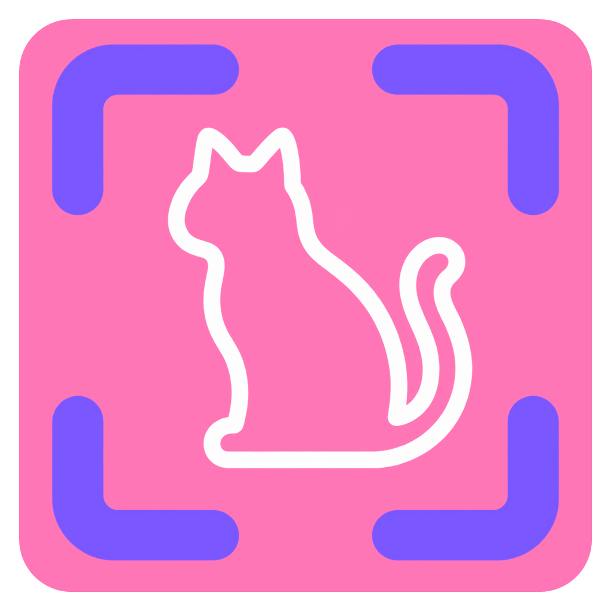
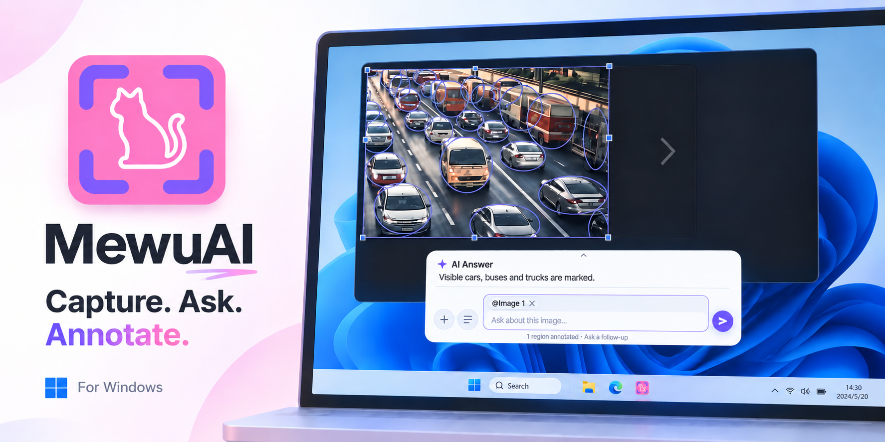
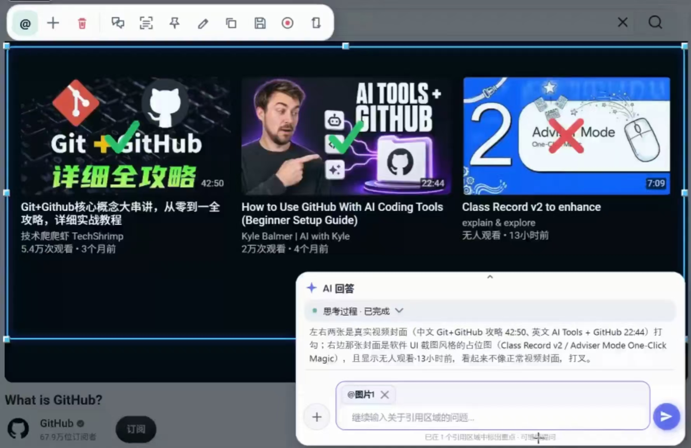
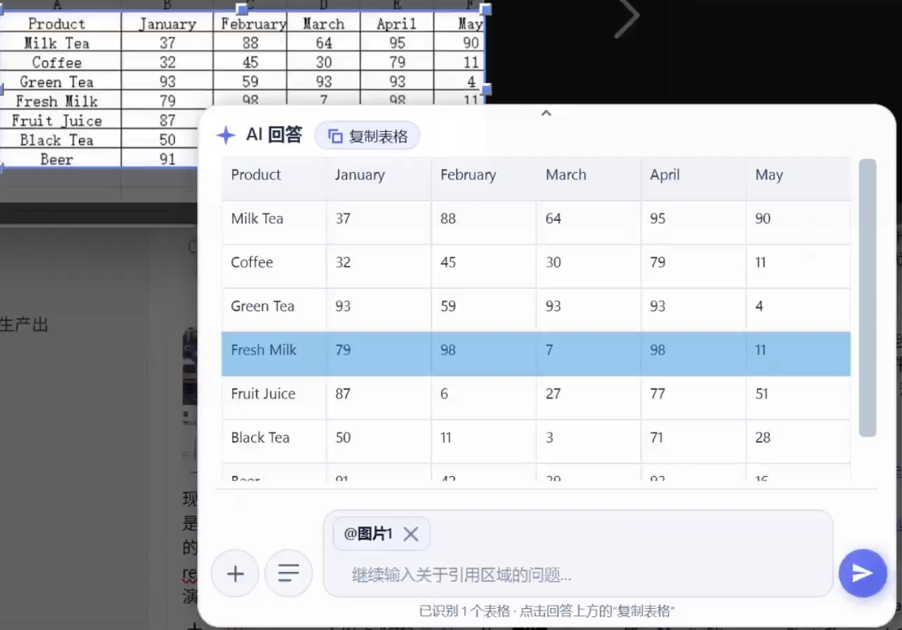
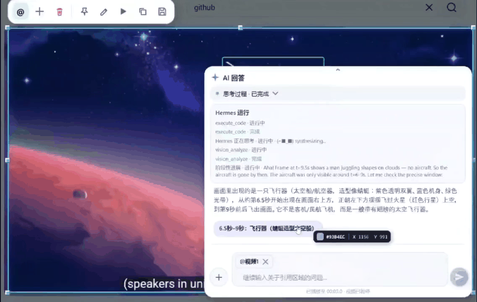
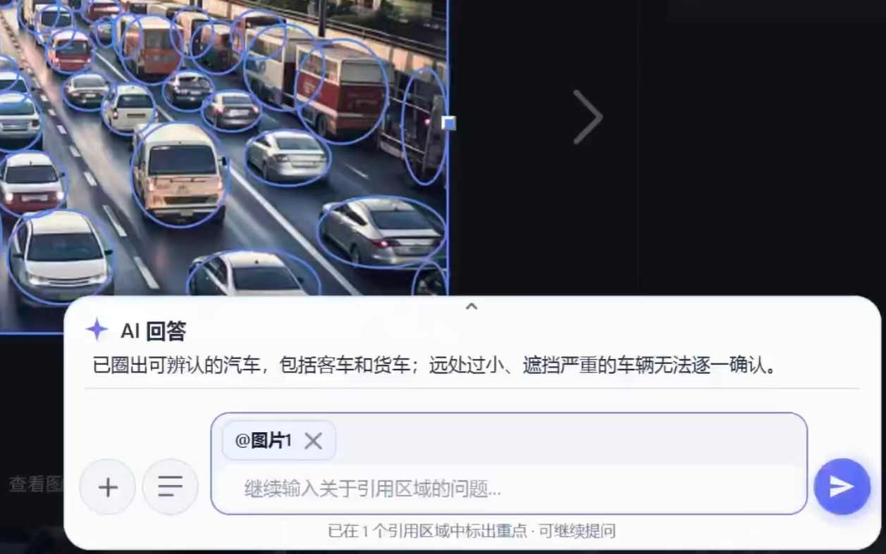
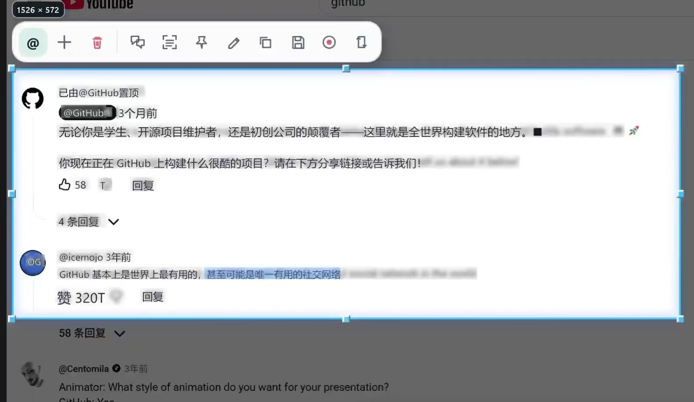
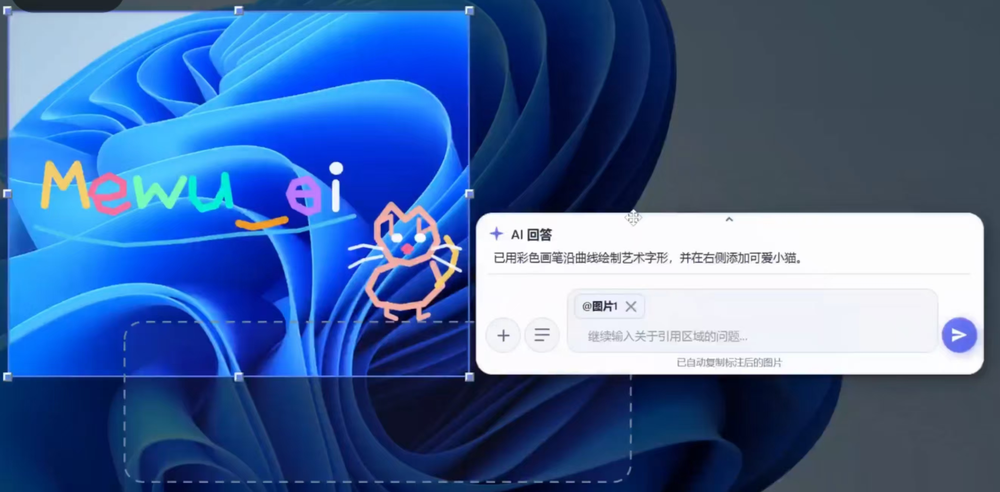
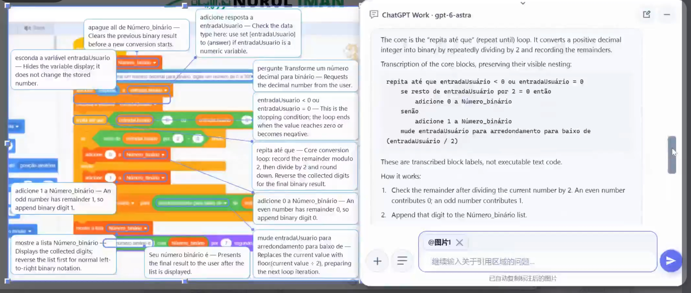
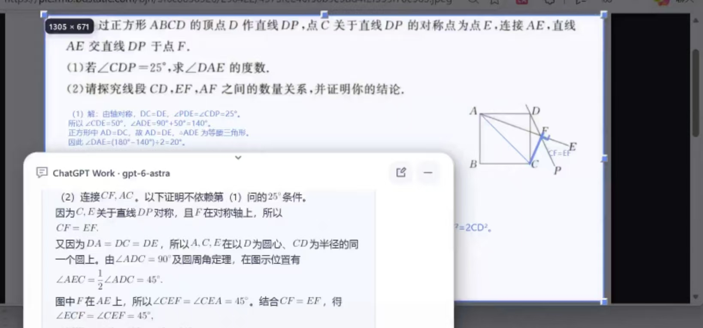

  
  <h1>MewuAI — Capture and AI Space</h1>
  <h1>BUT！It's still in beta</h1>
  
  
An open-source desktop space for screenshots, conversations, annotations and interactive AI results.

  

    
    
    
    
    
  

  

    <a href="https://github.com/abnste/mewu_ai/releases/download/v1.0.3/MewuAI-Setup-1.0.3-win-x64.exe"><strong>Windows installer</strong></a>
    &nbsp;·&nbsp; <a href="https://github.com/abnste/mewu_ai/releases/download/v1.0.3/MewuAI-Portable-1.0.3-win-x64.zip">Windows portable ZIP</a>
    &nbsp;·&nbsp; <a href="https://github.com/abnste/mewu_ai/releases/download/v1.0.3/MewuAI-1.0.3-mac-arm64.dmg">macOS ARM64</a>
    &nbsp;·&nbsp; <a href="https://github.com/abnste/mewu_ai/releases/download/v1.0.3/MewuAI-1.0.3-linux-x64.AppImage">Linux x64</a>
  

  
<a href="./README.zh-CN.md">简体中文</a> · <strong>English</strong> · <a href="./docs/release-notes-1.0.3.md">Release notes</a> · <a href="https://github.com/abnste/mewu_ai/issues">Report an issue</a>

**MewuAI (喵呜AI)** is an open-source **capture and AI space for Windows, macOS and Linux**. A shortcut opens the capture overlay itself: select regions, draw, pin images, add files and ask questions in the conversation bar. Interactive HTML/SVG/Canvas results can live alongside screenshots and videos on the same surface.

**喵呜AI（MewuAI）将快捷键唤起的截图界面作为 AI 空间**，保留截图与绘制操作，通过可选 Agent、长期记忆和插件连接更多能力。中文介绍见[中文首页](./README.zh-CN.md)。

| At a glance | Details |
| --- | --- |
| Platforms | Windows x64, macOS ARM64, Linux x64; English and Simplified Chinese |
| Core workflow | Capture → annotate/copy/save, or reference content → ask AI → interact with results |
| Without an AI key | Capture and built-in drawing/recording remain available; the conversation bar appears after configuring a model or explicitly binding an independent Agent provider |
| AI and plugins | Your model connections, permission-checked executable plugins, independent Agent and memory providers |
| Source and downloads | [1.0.3](https://github.com/abnste/mewu_ai/releases/tag/v1.0.3) · [Community plugin market](https://github.com/abnste/mewu-plugins) |
| License | [MPL-2.0](./LICENSE); [full third-party notices](./apps/desktop/THIRD-PARTY-NOTICES) |

**MewuAI 1.0.3** adds CLI control for local agents, improves Agent tool-error recovery and memory-source validation, and fixes blackboard editing and production startup issues. See the [release notes](./docs/release-notes-1.0.3.md).

MewuAI is maintained on **[master](https://github.com/abnste/mewu_ai/tree/master)**. The original Windows **.NET/WPF 0.7.x** code and documentation remain on **[dotnet](https://github.com/abnste/mewu_ai/tree/dotnet)**. MewuAI uses **Rust + Tauri 2 + Solid/TypeScript + SQLite** and the system webview; it does not use Electron.

  
   AI-generated concept cover from the .NET version. The gallery below contains historical .NET demonstrations, not current 1.0 screenshots.

## Features

- **Capture first:** Open the capture space, select regions or supported windows, draw, copy, save or pin content. Fresh installations need no model key for this workflow. Scrolling capture has a live side preview; automatic application snapshots depend on Windows UI Automation support.
- **Drawing and media objects:** Pens, adaptive arrows, shapes, text, numbered markers and highlights share two compact toolbars. Screenshot/blackboard erasers offer pixel and object modes, Undo/Redo and three fixed color slots, initially red, yellow and blue. Click to select, then click the selected color to edit. Imported images and videos remain movable objects; HTML/SVG/Canvas content stays interactive.
- **Text and tables:** Official capability plugins provide OCR, translation and table extraction. OCR is local; translation and AI table results need an appropriate connected model. Actionable recognition for links, email addresses, phone numbers and QR/barcodes is currently supported on Windows and macOS; it does not automatically send messages or make calls.
- **Recording and trimming:** Built-in region recording uses computer audio by default, with pause/resume, video annotations and MP4/MP3/GIF export. Actions sit above the video and the seek/trim bar below it. Trims preserve the original source; encoded output follows the video frame grid rather than promising sub-frame cuts.
- **Model connections:** Model discovery can try common API roots when only a service origin is entered. A working address appears in the settings draft and takes effect only when saved; explicit custom paths stay unchanged.
- **Conversation in the capture space:** Reference screenshots, videos or files with @ mentions, then follow up in the ordinary conversation bar. Multiple conversations, minimized sessions, history, Markdown, formulas and collapsible public reasoning are supported. The bar hides when the pointer leaves and preserves the draft when recalled.
- **Optional Agent and blackboard:** These are official plugins that can be disabled or removed; drawing and recording stay built in. With no ready model or explicitly bound independent Agent, Mewu shows capture controls. An independent provider may operate without a host API key when explicitly configured.
- **Executable plugins and a real market:** API ES Modules run in separate QuickJS processes. Plugins can register tools, Agent engines, memory providers, models, channels, renderers and UI services through permission-checked host APIs. The [GitHub market](https://github.com/abnste/mewu-plugins) installs real Release ZIPs and shows screenshots, project repositories, versions and package hashes. JSON declaration packages are no longer accepted; existing user data and built-in module preferences are preserved.
- **Long-term memory as an extension:** Choose Agent and memory providers independently. The official Agent supports persistent local SQLite/FTS5 memory and a Hindsight connection; community providers can supply their own stores. This release does not promise a complete replacement for Hermes plus Hindsight or guaranteed recall quality.

Build extensions with the [SDK](./packages/sdk/README.md), [extension guide](./docs/extensions.md) and [packaging tools](./tools/extension-market/README.md). Independent examples include the [region Agent](https://github.com/abnste/mewu-plugin-region-agent), [journal memory](https://github.com/abnste/mewu-plugin-journal-memory) and [interactive ruler](https://github.com/abnste/mewu-plugin-interactive-widget). Reference a region and send an instruction in the existing conversation bar; no separate region-task window is needed. The native region-input example currently supports **Windows only**.

The development SDK adds isolated client surfaces and plugin-owned object storage.
See the [plugin boundary audit](./docs/plugin-boundaries.md) for implemented interfaces,
remaining native coupling, and limits; service registration alone does not imply full product integration.

**CLI:** The default-enabled official CLI plugin lets local agents operate Mewu through `mewu schema` and fixed JSON commands, sharing the existing screenshot, conversation, drawing and recording paths. See the [CLI guide](./docs/cli.md) and [machine-readable catalog](./apps/desktop/control/catalog.json). Available starting with 1.0.3; earlier installers do not contain this interface.

Original .NET 0.7.x feature reference

The following descriptions belong to the original Windows version on [dotnet](https://github.com/abnste/mewu_ai/tree/dotnet). They are retained as project history, not a claim that every integration and interaction has been migrated into the current version.

- **Papers and assignments:** Reference exam screenshots in the ordinary conversation bar for explanations and annotations. Reference multiple screenshots to discuss shared problems and generate practice questions; readings and grading still need human review.

- **Screenshots and scrolling capture:** Select a region or window, capture across monitors, and capture long pages without a fixed segment limit. The compact inspector shows a hex color such as #FFFFFF above a borderless pixel magnifier with a central crosshair, and screen coordinates below it. Window-snapped selections offer app snapshots that capture supported scroll areas, restore their position, then pin and reference the result. Availability depends on the application's rendering and scrolling support.
- **Annotations and pinned images:** Choose pens, shapes, text, numbered markers, and mosaic from the first toolbar row; the second holds properties, undo, redo, clear, and done. The Select tool moves and edits existing objects; the number tool lets you set the next number. Highlights tint the background while protecting underlying text and detail. Hold Shift to constrain lines, arrows and shapes; moving or resizing the capture region preserves manual annotations. Done copies the annotated image automatically.
- **Transparent content lift and local repair:** Seamless lift repairs the original background and places the extracted text or artwork on a transparent layer that you can move, resize, or delete. The healing brush repairs content along a brush stroke. Both support undo and redo and work locally; they estimate nearby background and are intended for screenshot text and simple graphics, not general-purpose subject cutouts or generative photo editing.
- **Text and tables:** Copy text with offline OCR, translate screenshots while preserving each source line and separate columns, and use AI to extract tables for Excel. Long single-line translations fit their available line space by adjusting text size.
- **QR codes and memory fill:** Selected QR codes and barcodes show copy/open actions automatically; browse several codes in one compact card. Configure keyword/value mappings in Memory settings, then right-click the capture toolbar's Text button to scan and fill a form. Values are encrypted locally and each proposed field can be confirmed before filling.
- **Screen recording and trimming:** Record a region with computer audio and an optional microphone. Trim the start and end directly below the preview, seek, undo changes, or restore the full video without overwriting the source. Save, copy, pin, and AI references use the same retained clip, including its audio and timeline annotations. Previews use the original resolution by default; Recording settings offer a smaller preview without affecting saved video resolution. Export MP4 video, MP3 audio, or a GIF.
- **Ask about images and videos:** Reference several screenshots or attachments, ask follow-up questions, and click a time in an answer to jump to the relevant video scene.
- **Choose your AI:** Connect API services, Hermes, ChatGPT Work / Codex, WorkBuddy, or MiniMax Code. Switch between them and keep your last selection.
- **Screen actions and MCP services:** Recognize links, email addresses, and phone numbers; connect QQ Mail, NetEase Mail, DingTalk, Feishu, ima, or Obsidian for supported mail, sharing, and note workflows. See the [integration setup guide](https://github.com/abnste/mewu_ai/blob/dotnet/docs/mcp-integrations.md#english).

Screenshots, manual annotations, pinned images, text recognition, and recording work without an AI account. Translation, table extraction, and AI questions require a connected service.

## In development / TODO

- Broader Agent, memory, model and communication-channel plugins.
- Native region-input adaptation beyond Windows and more cross-platform parity.
- NVIDIA Instant Replay hardware compatibility checks and an application-wide live diagnostic log view.
- Dedicated image/video generation and richer multimodal/audio workflows.
- AIGC canvas editing and additional interactive renderers.
- More languages, lower resource use and better response efficiency.
- Further migration of original .NET integrations; their existing documentation remains on [dotnet](https://github.com/abnste/mewu_ai/tree/dotnet).

## Preview

**Historical gallery — original .NET version.** All eight demonstrations below are retained from the original README. They show the project's established feature direction and old interface, not current 1.0 screenshots or a guarantee of current feature parity.

<table>
<tr>
<td width="50%" valign="top">
<h3>Highlight details</h3>

Ask AI to circle items, add checkmarks, or leave notes on a screenshot. Continue with follow-up questions.

</td>
<td width="50%" valign="top">
<h3>Recognize tables</h3>

Turn a table screenshot into a structured answer, then use Copy table to paste it into Excel.

</td>
</tr>
<tr>
<td width="50%" valign="top">
<h3>Analyze videos</h3>

Click a time in an answer to jump to a scene. Annotations follow the subject while a marked segment plays.

</td>
<td width="50%" valign="top">
<h3>Annotate data</h3>

Ask AI to identify and mark objects in an image, such as visible vehicles in a traffic scene.

</td>
</tr>
<tr>
<td width="50%" valign="top">
<h3>Translate screenshots</h3>

Read translations where the original text appears, then select text to copy it.

</td>
<td width="50%" valign="top">
<h3>Draw and annotate</h3>

Ask AI to add a diagram, or add your own notes with pens, shapes, and text.

</td>
</tr>
<tr>
<td width="50%" valign="top">
<h3>Understand code</h3>

Select a piece of code and ask for an explanation tied to the lines you are reading.

</td>
<td width="50%" valign="top">
<h3>Annotate papers</h3>

Reference exam screenshots for explanations and annotations, or compare several pages to discuss shared errors and create practice.

</td>
</tr>
</table>

About the paper demonstration

The example shows explanations and in-place annotations for a geometry question. Check AI answers and annotations against the original question.

## Get started

> **Related project:** Our partner [**kangarooking/Ta**](https://github.com/kangarooking/Ta) is also an AI screenshot tool for macOS, with OCR, translation, scrolling capture and annotations. Mewu also provides a macOS ARM64 package.

1. **Install and open.** Use one of the four downloads above. Windows requires Windows 10 2004 or later and WebView2; macOS uses WKWebView and Linux uses WebKitGTK. No separate .NET installation is required for MewuAI.
2. **Capture a region.** Click the tray icon or use the capture shortcut; the Windows default is <kbd>Shift</kbd> + <kbd>Alt</kbd> + <kbd>S</kbd>. Select an area, then copy, save, annotate or record. Change the shortcut in Settings; Wayland may require desktop permission and shortcut setup.
3. **Connect AI when needed.** Configure a model under **Settings → Agent and connections**, or install and bind an independent Agent plugin. Agent and model selection are separate controls. Add a region reference or a file in the input to ask about it.

Linux Wayland capture/recording uses the desktop portal. After recording permission is granted, select the region again in the refreshed preview. Move recording controls outside the region; GNOME may not keep them on top. Linux needs system `libnghttp2.so.14`; local OCR needs Tesseract 4.1/5 and English language data (`libnghttp2-14` and `tesseract-ocr-eng` on Ubuntu).

New data defaults to `~/.mewu`. Existing installations keep their configured location; **Settings → Data** supports moving it and separate cleanup/space statistics for files, images and conversations. Back up important data before switching between the original and current versions.

## AI connections

| Connection | Current support |
| --- | --- |
| API | Chat Completions, OpenAI Responses and Anthropic Messages, with multiple saved connections and model templates. The selected service determines image/video support, cost and limits. |
| Independent Agent | API Agent-provider plugins can use their own runtime, with memory chosen separately. Host-model access uses the current connection and granted permissions. |
| MCP | Configure local MCP services under **Agent and connections → MCP**; installed plugin tools also join the existing Agent conversation. |

Hermes, ChatGPT Work / Codex, WorkBuddy and MiniMax Code desktop-client adapters are **not included in 1.0.3**. They remain extension work; general model templates do not mean their proprietary Agent protocols are implemented. Dedicated image/video-generation APIs and device synchronization are also not included. Actual AI annotations depend on model output and need review.

Original .NET desktop-client connection guide

These instructions apply to [dotnet](https://github.com/abnste/mewu_ai/tree/dotnet), not the current connection controls.

| Connection | What you need |
| --- | --- |
| API | Your provider's API key and a model. Search built-in China/global service templates, load their model catalogs, and save multiple independent connections. [Supported services and setup](https://github.com/abnste/mewu_ai/blob/dotnet/docs/api-providers.md). |
| Hermes | A configured Hermes installation on your PC. Choose a profile and model in settings. |
| ChatGPT Work / Codex | A signed-in ChatGPT Work / Codex installation on your PC. Choose a model and reasoning level in settings. |
| WorkBuddy | Install and sign in to WorkBuddy desktop, then connect and choose a model in settings. |
| MiniMax Code | Sign in to MiniMax Code desktop. You can open it from settings; no separate command-line installation is required. |

With multiple connections saved, click the **model button after Upload** in the conversation bar to choose one. Your configurations are kept, and the app remembers your last selection.

Image and video support depends on the selected model. MiniMax M3 is available through API or Hermes. Codex and WorkBuddy may need video-processing tools already installed on your PC to inspect videos. Check AI answers and annotations against the original content.

## FAQ

Does it cost anything?

Capture, built-in drawing and recording need no AI account. Official optional capabilities such as OCR can work locally. AI requests use the service or Agent provider you configure; that provider sets charges and usage limits.

Why are my selections and annotations missing from a screen share?

MewuAI has **Settings → General → Allow screen sharing to see selections and annotations**. Visibility still depends on the operating system and sharing application. The original .NET teaching-mode behavior and F8 instructions are documented on [dotnet](https://github.com/abnste/mewu_ai/blob/dotnet/README.md); they should not be assumed identical on every new platform.

Are screenshots and conversations uploaded automatically?

Capture and manual drawing are local. Using AI sends the referenced content and applicable context to your chosen service; plugins use the capabilities you grant them. Keys are stored through the native credential store. A connected service or Agent may use cloud processing.

How do I update? What if an older version cannot update?

Use **Settings → About** to check and install updates. MewuAI reads the [latest stable GitHub Release](https://github.com/abnste/mewu_ai/releases/latest) directly and selects the installer for your system. No separate update-feed or signature file is required. Downloaded packages retain version, size and cryptographic verification. Windows portable updates run the installer and switch to the installed application.

Earlier **0.7.4, 1.0.0 and preview installations** may still request an old feed or installer name. Install this version once from the official release without uninstalling first; subsequent updates use GitHub Releases directly.

Supported legacy API connections are imported once; legacy files remain, but old conversation history is not converted into the new history UI and preferences are not fully migrated. See the [1.0 upgrade notes](./docs/release-notes-1.0.3.md) and [earlier compatibility-entry details](./docs/legacy-updates.md). Release assets expose SHA-256 digests; no separate checksum file is required. The [old changelog](https://github.com/abnste/mewu_ai/blob/dotnet/CHANGELOG.md) remains available.

Having trouble installing or recording?

Windows packages have no Authenticode certificate yet; updater signature verification is separate. Download from the versioned [1.0.3 release](https://github.com/abnste/mewu_ai/releases/tag/v1.0.3). Windows N/KN may require the Media Feature Pack. On Linux, check portal permissions and the runtime requirements above. Report the platform, version and reproduction steps in [Issues](https://github.com/abnste/mewu_ai/issues).

## Contributing

Bug reports, suggestions, code, plugins and documentation improvements are welcome. The [desktop guide](./apps/desktop/README.md), [extension SDK](./packages/sdk/README.md) and [release guide](./docs/releasing.md) describe the current Rust/Tauri/Solid project. Browser development previews do not provide native capture or recording.

The original [contributing guide](https://github.com/abnste/mewu_ai/blob/dotnet/CONTRIBUTING.md), [code of conduct](https://github.com/abnste/mewu_ai/blob/dotnet/CODE_OF_CONDUCT.md) and [security policy](https://github.com/abnste/mewu_ai/blob/dotnet/SECURITY.md) are retained with the .NET branch.

## License

Project-owned source remains licensed under [MPL-2.0](./LICENSE). Commercial use is permitted under the license. When distributing covered software, provide the covered source and retain copyright and license notices as required. Full [third-party notices](./apps/desktop/THIRD-PARTY-NOTICES) ship with the packages; released source is linked from each version tag. The original [license and source information](https://github.com/abnste/mewu_ai/blob/dotnet/SOURCE.md) remains on dotnet.

## Acknowledgments

Thanks to teachers **Lin Wenjie** for subject-matter guidance and **Zhang Wenbiao** for feature development suggestions, and to [**blueling0**](https://github.com/blueling0) for testing assistance.
