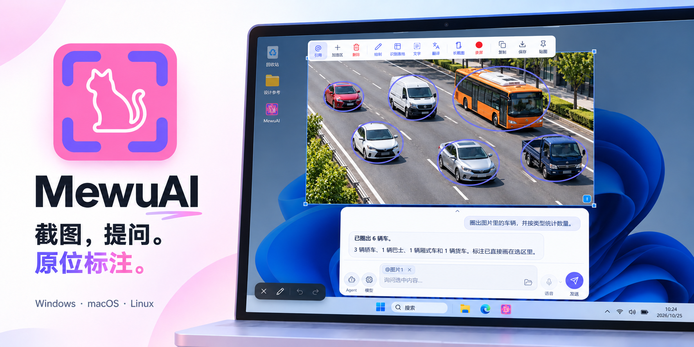

<div align="center">
  
  <h1>喵呜AI（MewuAI）— 个人 Agent 与 AI 创意画布</h1>
  <p>由 LLM 驱动的开源桌面应用，连接对话、视觉标注、创作工具与桌面操作。</p>
  <p>
    <a href="https://github.com/abnste/mewu_ai/releases/latest"></a>
    
    
    
    <a href="./LICENSE"></a>
  </p>
  <p><a href="https://www.mewu.ai/download.php?platform=windows"><strong>Windows 安装版</strong></a> &nbsp;·&nbsp; <a href="https://www.mewu.ai/download.php?platform=portable"><strong>Windows 便携版</strong></a> &nbsp;·&nbsp; <a href="https://www.mewu.ai/download.php?platform=macos"><strong>macOS ARM64</strong></a> &nbsp;·&nbsp; <a href="https://www.mewu.ai/download.php?platform=linux"><strong>Linux x64</strong></a></p>
  <p><strong>简体中文</strong> · <a href="./README.md">English</a> · <a href="https://www.mewu.ai/?lang=zh">官网</a> · <a href="https://github.com/abnste/mewu_ai/releases/latest">更新说明</a> · <a href="https://github.com/abnste/mewu_ai/issues">问题反馈</a></p>
</div>

**喵呜AI（MewuAI）是一款跨 Windows、macOS 和 Linux 的开源 Agent 终端应用。** 框选屏幕内容，用标注、手绘和文件向 AI 表达具体需求；在同一个空间里对话、整理素材、生成交互控件，并通过工具与插件完成操作。**Mewu with you**，Mewu 与你一起工作。

| 产品速览 | 说明 |
| --- | --- |
| 支持系统 | Windows x64、macOS ARM64、Linux x64；简体中文与 English 界面 |
| 核心能力 | 个人 Agent、AI 创意画布、视觉标注、HTML 交互工具、CLI 与插件 |
| 日常操作 | 框选自动引用 → 描述任务 → 使用、标注或继续修改结果 |
| 本地能力 | 截图、手工绘制、贴图、本地 OCR 与录屏无需 AI 账号 |
| AI 接入 | 自选模型连接、外部 Agent、MCP 工具与独立记忆提供方 |
| 官方来源 | [最新发行](https://github.com/abnste/mewu_ai/releases/latest) · [插件市场](https://github.com/abnste/mewu-plugins) |

<p align="center">
  <a href="./docs/images/mewuai-cover-current-zh.png"></a>
  <br /><sub>截图、提问、原位标注。</sub>
</p>

## 功能

- **个人 Agent**：选择角色、模型、工具与记忆；引用图片、视频和文件继续对话，保留会话历史，支持 Markdown、公式与可折叠的公开思考。官方 Agent 提供本地持久记忆，也可连接独立记忆服务。
- **AI 创意画布**：整理图片、视频、文字与生成对象，移动、缩放、置顶或收藏。用自然语言生成 HTML / SVG / Canvas 内容，直接使用计算器、实验面板或小游戏，再继续提出修改要求。
- **截图与多选区**：单区、多区、长截图和受支持的窗口截图。框选后自动加入对话引用，非选区压暗；同时对照多个来源，无需再手动点击“引用”。
- **绘制与标注**：画笔、箭头、形状、文字、序号、高亮和马赛克，配合撤销、重做及对象编辑。可以手工标注，也可以让 AI 对着试卷、代码等具体内容解释、圈出重点。
- **文字与表格**：本地 OCR、截图翻译、图表理解与表格提取。Windows/macOS 还支持链接、邮箱、电话号码、二维码与条码的可操作识别。
- **录屏与视频标注**：录制电脑声音与麦克风，暂停、继续、裁剪并导出 MP4 / MP3 / GIF；对指定时间段添加框线和文字，点击对话中的时间定位画面。音频能力取决于系统。
- **电子黑板**：在全屏黑板上手绘、推导和讲解，将题目、公式和 AI 分析放在一起；共享演示时可允许共享软件看到选区与标注。
- **CLI 与区域 AI 操作**：本机 Agent 可通过命令行读取场景、截图、添加选区、绘制和导出；区域操作插件让模型观察指定区域、执行动作，再根据新截图继续。
- **插件与事件触发器**：独立扩展 Agent、记忆、工具与界面。官方 Hooks 支持定时、提示词、AI 回复、全局快捷键和应用／插件事件，串联 Mewu 操作、MCP、命令与键鼠动作。
- **技能与自制插件**：内置 Agent 可读取标准 `SKILL.md` 技能，创建、校验插件工程并打包，在“已安装 → 自制”中审核权限后安装。插件可通过[通用布局服务](./docs/plugin-toolbar-layout.md)调整原截图工具条顺序；详见[技能与插件制作](./docs/agent-skills.md)。

截图、绘制和录屏可以直接使用；AI 对话、翻译及生成结果需要配置相应服务。

## 开发中 / TODO

- 参考图生成与专用图像、视频生成模型接入。
- 即圈即搜、桌面宠物插件与更多桌面协作方式。
- 更多平台适配、语言支持与性能优化。

## 功能演示

<table>
<tr>
<td width="50%" valign="top">
<h3>试卷批注</h3>
<p>引用试卷截图讲解题目，在原题上补充辅助线、推导与批注。</p>
<a href="./docs/images/exam-annotation-latest.jpg"></a>
</td>
<td width="50%" valign="top">
<h3>生成 HTML 控件</h3>
<p>描述需要的工具，生成可点击、可调节的交互内容，继续使用和修改。</p>
<a href="./docs/media/readme/interactive-tools.gif"></a>
</td>
</tr>
<tr>
<td width="50%" valign="top">
<h3>AI 创意画布</h3>
<p>把分镜、图片与对话放在一起，整理参考素材并讨论创作方案。</p>
<a href="./docs/media/readme/creative-canvas.gif"></a>
</td>
<td width="50%" valign="top">
<h3>电子黑板</h3>
<p>手绘坐标系、曲线与说明，用不同颜色讲解推导过程，结合题目继续讨论。</p>
<a href="./docs/media/readme/blackboard.gif"></a>
</td>
</tr>
<tr>
<td width="50%" valign="top">
<h3>视频标注</h3>
<p>标注视频中的指定时间段，播放查看，点击时间回到对应画面。</p>
<a href="./docs/media/readme/video-annotations.gif"></a>
</td>
<td width="50%" valign="top">
<h3>CLI 截图与绘制</h3>
<p>从终端调用截图、添加选区和绘制接口，Mewu 界面同步呈现结果。</p>
<a href="./docs/media/readme/cli-screen-control.gif"></a>
</td>
</tr>
<tr>
<td width="50%" valign="top">
<h3>文字识别</h3>
<p>在本机识别截图文字，将需要的内容提取出来。</p>
<a href="./docs/media/readme/ocr.png"></a>
</td>
<td width="50%" valign="top">
<h3>代码讲解</h3>
<p>框选代码，解释逻辑，标出出错位置，并在原图旁给出修正。</p>
<a href="./docs/media/readme/code-explanation.gif"></a>
</td>
</tr>
<tr>
<td width="50%" valign="top">
<h3>表格识别</h3>
<p>把截图中的表格整理成行列清楚的数据，方便复制、对照和继续分析。</p>
<a href="./docs/media/readme/table.png"></a>
</td>
<td width="50%" valign="top">
<h3>外部 Agent</h3>
<p>在原有对话条接入 Codex、MiniMax Code、WorkBuddy / CodeBuddy 或 Hermes。</p>
<a href="./docs/media/readme/external-agents.jpg"></a>
</td>
</tr>
</table>

<details>
<summary>演示素材说明</summary>

动图采用 Mewu 界面组件与预置示例内容展示操作，生成结果随模型和提示词变化。视频标注按设定时间段显示，不代表已提供自动目标追踪。试卷批注保留原 README 的案例截图；代码讲解使用当前 Mewu 界面重新录制。外部 Agent 配图来自该插件公开的原生界面截图。[素材与来源](./docs/media/readme/README.md)。

</details>

## 开始使用

1. **安装并打开。** 选择顶部对应平台的安装包。Windows 使用 WebView2；macOS 将应用移入“应用程序”；Linux 为 AppImage 添加执行权限后启动。全部下载跟随[最新正式发行](https://github.com/abnste/mewu_ai/releases/latest)。
2. **进入空间。** 从托盘或截图快捷键唤起 Mewu，框选、绘制、保存，或打开黑板。截图快捷键在 **Hooks** 中配置；按系统提示授予截图、录屏等权限。
3. **连接 AI。** 在 **设置 → Agent 与连接** 添加模型，选择角色与记忆，或通过外部 Agent 插件连接已有客户端。框选会自动成为引用，在底部对话条发送任务。

Linux 的系统依赖与桌面权限见 [AppImage 使用说明](./docs/linux-appimage-permissions.md)及[录屏说明](./docs/linux-native-recording.md)。区域 AI 操作支持 Windows、macOS 与符合条件的 GNOME 50 Wayland x64；Linux 还需 [Desktop Witness](./tools/linux-desktop-witness/README.md) 和 Portal 授权。

## 支持的 AI

| 接入方式 | 如何使用 |
| --- | --- |
| 模型 API | 配置 Chat Completions、OpenAI Responses 或 Anthropic Messages 服务，保存多个独立连接，选择所需模型。 |
| 外部 Agent | 通过[独立插件](https://github.com/abnste/mewu-plugin-agent-connectors)连接 Codex、MiniMax Code、WorkBuddy / CodeBuddy、Hermes，沿用相应客户端的登录和配置。 |
| 记忆 | Agent 与记忆独立选择；使用官方本地持久记忆，或通过插件连接 Hindsight 等记忆服务。 |
| MCP 与工具 | 在 **Agent 与连接 → MCP** 添加服务，或启用插件工具，让当前 Agent 在对话中调用。 |

图片、视频与工具调用能力、费用和额度由所选服务决定。外部 Agent 需安装并登录对应客户端，各平台的支持范围以插件文档为准。

## 插件市场

在 **设置 → 插件** 浏览、安装和管理扩展，也可以导入插件发行 ZIP。[查看完整市场](https://github.com/abnste/mewu-plugins)。

| 插件 | 用途 |
| --- | --- |
| [Hooks · 事件触发器](./docs/hooks.md) | 官方自带、默认启用。组合触发条件与动作，每条规则可独立开关、编辑和查看运行记录。 |
| [外部 Agent](https://github.com/abnste/mewu-plugin-agent-connectors) | 将已配置的客户端接入 Mewu 的角色与对话。 |
| [区域 AI 操作](https://github.com/abnste/mewu-plugin-region-agent) | 框选目标并描述任务，模型根据连续观察执行区域内操作。 |
| [Hindsight 记忆](https://github.com/abnste/mewu-plugin-hindsight) | 连接自己的 Hindsight 服务与记忆库。 |
| [日志记忆](https://github.com/abnste/mewu-plugin-journal-memory) | 为角色选择独立的日志式记忆提供方。 |
| [Mewu 工具包](https://github.com/abnste/mewu-plugin-object-toolbox) | 收藏图片、视频、HTML 与绘制对象，按文件夹整理，拖出复用。 |
| [研究便笺](https://github.com/abnste/mewu-plugin-research-notes) | 在空间中记录笔记、拖入参考对象并保存。 |
| [交互圆角尺](https://github.com/abnste/mewu-plugin-interactive-widget) | 在画布中使用可移动、可调节的 HTML / SVG 测量工具。 |

## 命令行

先运行桌面应用，再打开终端。CLI 与用户共同操作同一个 Mewu 空间：

```sh
mewu                         # 进入 Agent 对话
mewu status                  # 查看应用与当前场景
mewu schema                  # 查询操作与参数
mewu call capture.open --json '{}' --wait
```

普通 `mewu chat` 默认发送文字；截图与文件需显式提供引用。命令安装、平台要求和完整参数见 [CLI 文档](./docs/cli.md)与[操作目录](./apps/desktop/control/catalog.json)。

## 常见问题

<details>
<summary>必须配置 AI 吗？需要付费吗？</summary>

截图、手工绘制、录屏和本地 OCR 不需要 AI 账号。AI 对话与生成使用你配置的服务或外部 Agent，费用和额度由相应服务决定；MewuAI 本身开源。

</details>

<details>
<summary>为什么会议共享看不到截图和标注？</summary>

在 **设置 → 通用 → 允许屏幕共享看到框选和标注** 调整。实际可见性也取决于系统与共享软件。

</details>

<details>
<summary>截图和对话会发到哪里？</summary>

截图与手工绘制在本机完成。使用 AI 时，引用内容与相关上下文发送给你选择的服务；插件使用你授予的权限，外部 Agent 沿用其自己的运行配置。

</details>

<details>
<summary>如何更新或反馈问题？</summary>

在 **设置 → 关于** 检查更新，或下载[最新发行](https://github.com/abnste/mewu_ai/releases/latest)。Windows 便携版的内置更新会转为安装版；希望保留便携使用时，请下载新的便携包。

遇到问题请提交 [Issue](https://github.com/abnste/mewu_ai/issues)，附系统、软件版本、复现步骤与必要截图。

</details>

## 参与项目

欢迎反馈问题、分享场景，贡献代码、插件和文档。桌面应用采用 **Rust + Tauri 2 + SolidJS / TypeScript + SQLite**，通过系统 WebView 呈现界面。

[桌面开发指南](./apps/desktop/README.md) · [扩展 SDK](./packages/sdk/README.md) · [扩展接口](./docs/extensions.md) · [插件打包与投稿](./tools/extension-market/README.md) · [发行指南](./docs/releasing.md)

浏览器预览用于界面开发；原生截图、录屏与系统输入需在桌面环境中运行。

## 项目成员

<a href="https://github.com/abnste"></a> <a href="https://github.com/pyxyd"></a> <a href="https://github.com/shuziyuxingxing-stack"></a> <a href="https://github.com/AndeDrCobb"></a> <a href="https://github.com/tljsj"></a>

## 开源协议

项目自有源码采用 [MPL-2.0](./LICENSE)，允许遵守协议的商业使用。对外分发时应按协议提供受覆盖源码，保留版权与许可声明。[第三方许可](./apps/desktop/THIRD-PARTY-NOTICES)随安装包提供。

## 致谢

感谢 **林文杰老师** 提供学科帮助，**张文彪老师** 提供功能开发建议，以及 [**blueling0**](https://github.com/blueling0) 协助测试。
