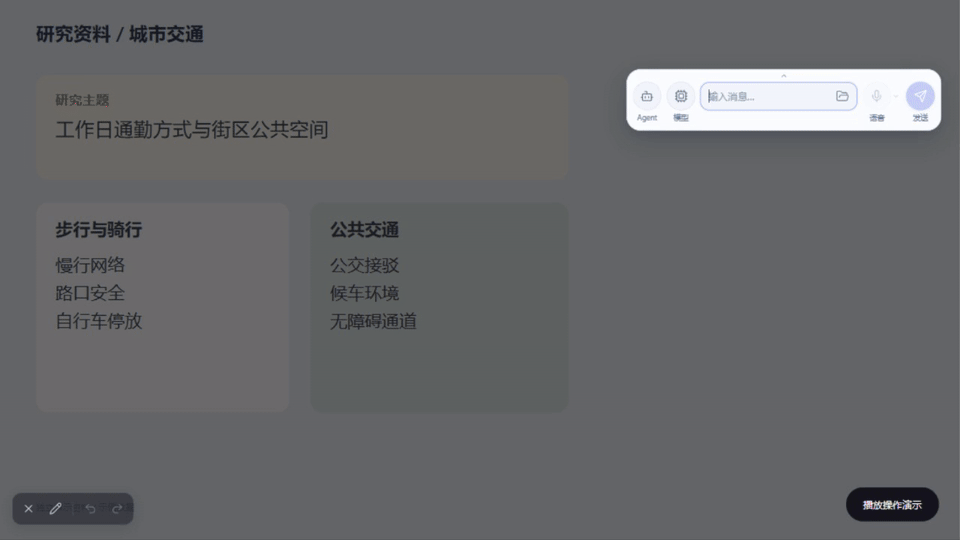
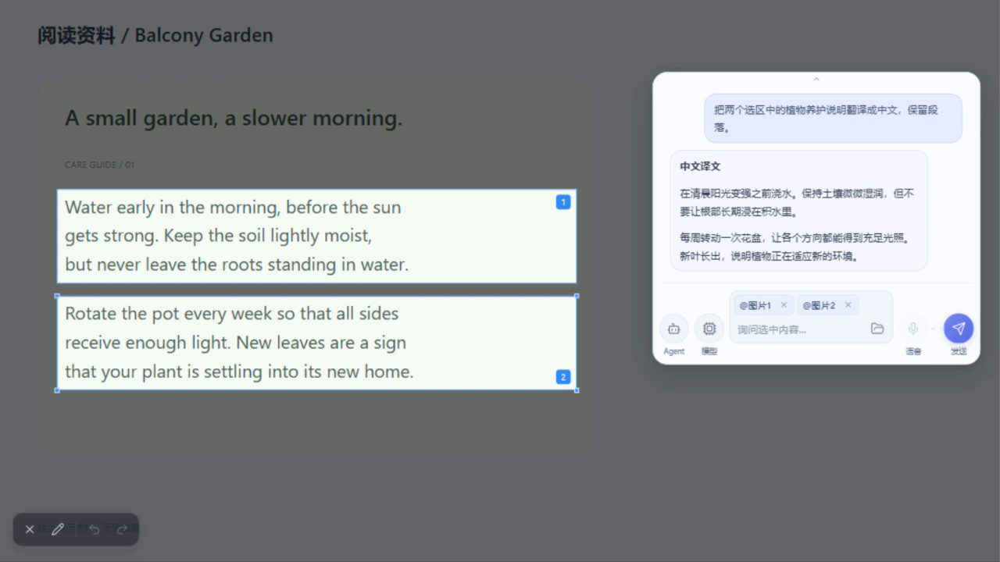

<div align="center">
  
  <h1>MewuAI · 喵呜AI</h1>
  <p><strong>由 LLM 驱动的个人 Agent 与 AI 创意画布</strong></p>
  <p>Mewu with you — 与你一起看、画、创作和完成桌面工作。</p>
  <p>
    <a href="https://github.com/abnste/mewu_ai/releases/latest"></a>
    
    <a href="./LICENSE"></a>
  </p>
  <p><strong>简体中文</strong> · <a href="./README.md">English</a> · <a href="https://www.mewu.ai/?lang=zh">官网与交互演示</a> · <a href="https://github.com/abnste/mewu_ai/releases/latest">最新发行</a></p>
  <p><a href="https://www.mewu.ai/download.php?platform=windows"><strong>下载 Windows 版</strong></a>　·　<a href="https://www.mewu.ai/download.php?platform=macos"><strong>下载 macOS 版</strong></a>　·　<a href="https://www.mewu.ai/download.php?platform=linux"><strong>下载 Linux 版</strong></a></p>
</div>

MewuAI 是一个开源桌面 Agent 应用。把屏幕中的内容框选给 AI，用文字、箭头和手绘说明细节，在同一个空间里讨论、生成交互工具、整理素材，再通过 CLI、MCP 和插件完成操作。截图、录屏和标注是表达工具；你选择的模型、Agent 与记忆共同参与工作。


**看得见上下文，也能直接使用结果。** 选区自动成为引用；生成的 HTML 可以留在画布上点击、输入和拖动，继续与对话协作。

[功能演示](#功能演示) · [使用场景](#使用场景) · [插件市场](#插件市场) · [开始使用](#开始使用) · [开发与贡献](#开发与贡献) · [项目成员](#项目成员)

## 功能演示

### 框选即引用，让 AI 看清具体位置

在桌面连续框选多个区域，选区会自动加入当前对话的引用，非选区压暗。可以同时比较几段文字、几张图或不同窗口的内容，无需整屏发送，也无需再点击一次“引用”。

- 用手绘、箭头、矩形和文字补充要求，指出修改位置或需要解释的细节。
- 在原位置查看结果，或将内容复制、保存、置顶，继续整理。
- 单区、多区、长截图与录屏共用桌面工作空间。



### AI 创意画布，组织素材与对话

把图片、视频、文字和生成对象放在同一张画布上，调整大小和位置，建立参考关系。每个项目与会话保留自己的内容；Agent 角色、模型连接和记忆可以分别配置。适合比较设计稿、整理研究资料、讨论画面构图或推进一个创作项目。

- **多模态对话：** 引用图片、视频和文件，保留会话历史，支持 Markdown、公式与可折叠的公开思考。
- **角色与记忆：** 自定义 Agent 设定，选择模型和工具；官方 Agent 支持本地持久记忆，也可通过插件连接独立记忆服务。


### 用自然语言生成 HTML 交互工具

描述你需要的计算器、可视化实验、任务面板或小游戏，让 AI 生成 HTML / SVG / Canvas 内容。结果作为可交互对象放在空间中，可以输入、点击、拖动，也可以继续提出修改要求。下面的粒子实验展示模式切换与参数调节。


### 视频标注与时间定位

导入视频或录制屏幕，对指定时间段添加框线和文字；点击对话里的时间标记，回到对应画面继续查看。下面用一只沿围栏行走的狸花猫演示分段标注、播放和时间跳转。


标注按设定时间范围显示；连续时段可以设置不同位置。录屏还支持系统声音与麦克风、暂停与继续、非破坏性裁剪，以及 MP4、MP3、GIF 导出，具体音频能力取决于系统。

### 电子黑板与手绘讲解

打开黑板，用笔迹、几何图形、公式和颜色讲清楚推导过程。可以配合题目截图进行讲解，也可以把手绘内容交给 AI 继续分析；用于屏幕共享时，可在设置中允许共享软件看到框选和标注。


### 文字识别、翻译与表格提取

截图后的基础工具同样保留：本地 OCR 提取文字，翻译选中内容，借助支持图像的模型解释图表、把截图中的表格整理成可复用的数据。下面分别展示文字提取、原位翻译与表格整理。

<table>
  <tr>
    <td width="50%"><a href="./docs/media/readme/ocr.png"></a><br><strong>文字识别</strong> · 提取截图中的文字</td>
    <td width="50%"><a href="./docs/media/readme/translate.png"></a><br><strong>文字翻译</strong> · 对照原文查看译文</td>
  </tr>
</table>


Windows 与 macOS 还支持链接、邮箱、电话号码和二维码／条码的可操作识别。

### CLI，让其他 Agent 操作同一个 Mewu 空间

`mewu` 既可以在终端中对话，也提供截图、添加选区、绘制、OCR、录屏和导出图片等固定操作接口。本机 Agent 可以读取当前场景、提交操作，再查看实际结果，与用户共同使用同一个桌面空间。


先运行桌面应用，再打开终端：

```sh
mewu                         # 进入 Agent 对话
mewu status                  # 查看当前应用与会话
mewu schema                  # 查询可用操作及参数
mewu call capture.open --json '{}' --wait
```

普通 `mewu chat` 默认只发送文字；截图与文件需通过对应引用接口提供。接口参数、安装后的命令行集成和 Linux 要求见 [CLI 文档](./docs/cli.md)与[操作目录](./apps/desktop/control/catalog.json)。

## 使用场景

| 你正在做的事 | 在 Mewu 中怎样完成 |
| --- | --- |
| 阅读资料、比较信息 | 连续框选多个来源，让 AI 对照解释；把重点整理到画布或笔记中。 |
| 审阅设计与内容 | 圈出局部、画箭头、加文字，直接说明“修改哪里、保留什么”。 |
| 教学与解题 | 引用题目，手绘推导过程，在黑板上讲解，再让 AI 协助检查。 |
| 视频复盘 | 对关键时间段加标注，通过对话中的时间按钮反复定位片段。 |
| 制作小工具 | 描述交互需求，生成可点击的 HTML 控件，边使用边修改。 |
| 自动化桌面工作 | 用 CLI、区域 AI 操作或 Hooks 串联截图、工具调用和本机动作。 |

## 插件市场

在 **设置 → 插件** 中查看、安装和管理扩展。Agent、记忆、工具与界面能力可以独立扩展；插件可从市场安装，也可以导入发行 ZIP。查看[完整插件市场](https://github.com/abnste/mewu-plugins)。

### Hooks · 官方事件触发器

Hooks 随 Mewu 安装、默认启用。在设置侧栏打开 **Hooks**，把触发条件和动作组合为规则；每条规则可独立开关、编辑，并查看运行记录。

| 什么时候触发 | 可以接着做什么 |
| --- | --- |
| 到达设定时间（Cron） | 发送任务、打开应用或运行命令。 |
| 用户提示词匹配条件 | 为当次请求注入补充要求，或调用工具。 |
| AI 回复完成 | 调用已配置的 MCP 工具，或继续本机工作流。 |
| 按下全局快捷键 | 唤起截图、打开黑板或执行一组动作。 |
| 应用、插件或自定义事件发生 | 按条件串联 Mewu 操作、键鼠动作与其他事件。 |

规则支持动作排序、条件、冷却和运行记录。详见 [Hooks 使用说明](./docs/hooks.md)。

### Agent、记忆与工具扩展

| 插件 | 用途 |
| --- | --- |
| [外部 Agent](https://github.com/abnste/mewu-plugin-agent-connectors) | 将 Codex、MiniMax Code、WorkBuddy / CodeBuddy、Hermes 接入原有对话条，沿用相应客户端的登录与配置。 |
| [区域 AI 操作](https://github.com/abnste/mewu-plugin-region-agent) | 框选目标，描述任务；模型观察区域、执行动作，再根据新截图继续。 |
| [Hindsight 记忆](https://github.com/abnste/mewu-plugin-hindsight) | 连接自己的 Hindsight 服务与记忆库，为角色选择长期记忆。 |
| [日志记忆](https://github.com/abnste/mewu-plugin-journal-memory) | 为 Agent 选用独立的日志式记忆提供方。 |
| [Mewu 工具包](https://github.com/abnste/mewu-plugin-object-toolbox) | 收藏图片、视频、HTML 和绘制对象，拖出复用，按文件夹整理。 |
| [研究便笺](https://github.com/abnste/mewu-plugin-research-notes) | 在空间中记录、整理和复用笔记。 |
| [交互圆角尺](https://github.com/abnste/mewu-plugin-interactive-widget) | 在画布中使用可移动、可调节的 HTML / SVG 测量工具。 |

外部 Agent 需要安装并登录相应客户端，支持范围以各插件文档为准。区域 AI 操作支持 Windows、macOS 和符合条件的 GNOME 50 Wayland x64；Linux 还需 Desktop Witness 与系统 Portal 授权，详见插件说明。

**后续方向：** 参考图生成与专用图像／视频生成模型接入、即圈即搜、桌面宠物插件。这些能力仍在规划中，未作为已发布功能列出。

## 开始使用

| 平台 | 下载与安装 |
| --- | --- |
| **Windows x64** | [安装版](https://www.mewu.ai/download.php?platform=windows) · [便携版](https://www.mewu.ai/download.php?platform=portable)。使用系统 WebView2。 |
| **macOS Apple Silicon** | [下载 DMG](https://www.mewu.ai/download.php?platform=macos)，将应用移入“应用程序”，按系统提示授予屏幕录制等权限。 |
| **Linux x64** | [下载 AppImage](https://www.mewu.ai/download.php?platform=linux)，添加执行权限后启动。参阅 [AppImage 与桌面授权](./docs/linux-appimage-permissions.md)。 |

下载入口跟随最新正式发行；全部文件与更新说明见 [GitHub Releases](https://github.com/abnste/mewu_ai/releases/latest)。

1. **先用桌面工具。** 从托盘或截图快捷键进入空间，框选、绘制、保存，或打开黑板。截图快捷键可在 Hooks 中设置。
2. **连接 AI。** 在 **设置 → Agent 与连接** 添加模型服务，选择角色、模型与记忆；也可以通过外部 Agent 插件接入已有客户端。
3. **带着内容提问。** 框选会自动加入引用，在底部对话条发送任务。根据需要启用 MCP 与插件工具。

模型连接支持 Chat Completions、OpenAI Responses 和 Anthropic Messages 接口；可配置多个独立连接。图片、视频与工具调用能力由所选模型和服务决定。

### 常见问题

<details>
<summary><strong>必须配置 AI 才能用吗？需要付费吗？</strong></summary>

截图、手工绘制、录屏和本地 OCR 不需要 AI 账号。AI 对话及生成内容使用你配置的服务或外部 Agent，费用与额度由相应服务决定；MewuAI 本身是开源项目。

</details>

<details>
<summary><strong>截图和对话会发到哪里？</strong></summary>

截图和手工绘制在本机完成。使用 AI 时，所引用的内容及相关上下文会发送给你选择的服务。插件使用你授予的权限，外部 Agent 沿用其自己的运行配置。

</details>

<details>
<summary><strong>如何更新、反馈问题？</strong></summary>

在 **设置 → 关于** 检查更新，或从[最新发行](https://github.com/abnste/mewu_ai/releases/latest)下载安装包。Windows 便携版的内置更新会转为安装版；希望保持便携使用时，请下载新的便携包。

遇到问题可提交 [Issue](https://github.com/abnste/mewu_ai/issues)，附上系统、软件版本、复现步骤与必要的截图。录屏和截图受系统授权与桌面环境影响，Linux 可参阅[录屏说明](./docs/linux-native-recording.md)。

</details>

## 开发与贡献

桌面应用使用 **Rust + Tauri 2 + SolidJS / TypeScript**，通过系统 WebView 呈现界面，使用 SQLite 保存项目与会话。浏览器开发预览可调试界面；原生截图、录屏与系统输入需要桌面运行环境。

| 文档 | 内容 |
| --- | --- |
| [桌面开发](./apps/desktop/README.md) | 环境准备、开发与构建。 |
| [CLI](./docs/cli.md) · [操作目录](./apps/desktop/control/catalog.json) | 让脚本及其他本机 Agent 控制 Mewu。 |
| [Hooks](./docs/hooks.md) | 事件、条件、动作与运行规则。 |
| [扩展 SDK](./packages/sdk/README.md) · [扩展接口](./docs/extensions.md) | 编写独立插件，注册工具、Agent、记忆与界面服务。 |
| [插件打包与投稿](./tools/extension-market/README.md) | 发布独立插件并提交市场。 |
| [发行指南](./docs/releasing.md) | 桌面安装包与发行流程。 |

欢迎贡献代码、插件、文档、使用案例与问题反馈。

## 项目成员

<table>
  <tr>
    <td align="center"><a href="https://github.com/abnste"><br>Abner Stephen</a></td>
    <td align="center"><a href="https://github.com/pyxyd"><br>Yandi</a></td>
    <td align="center"><a href="https://github.com/shuziyuxingxing-stack"><br>数字与星星</a></td>
    <td align="center"><a href="https://github.com/AndeDrCobb"><br>Cobb</a></td>
    <td align="center"><a href="https://github.com/tljsj"><br>tljsj</a></td>
  </tr>
</table>

[查看全部贡献者](https://github.com/abnste/mewu_ai/graphs/contributors)

## 开源协议与致谢

MewuAI 自有源码采用 [MPL-2.0](./LICENSE)，允许遵守协议的商业使用。分发时应按协议提供受覆盖源码，并保留版权与许可声明。[第三方许可](./apps/desktop/THIRD-PARTY-NOTICES)随安装包提供。

感谢 **林文杰老师** 提供学科帮助，**张文彪老师** 提供功能开发建议，以及 [**blueling0**](https://github.com/blueling0) 协助测试。也感谢每一位报告问题、分享场景和参与贡献的用户。

演示采用 Mewu 界面组件与预置示例内容，展示操作方式；生成结果会随模型与提示词变化。[演示素材与来源](./docs/media/readme/README.md)。
