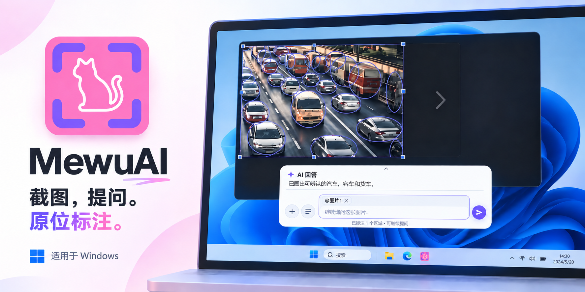

  
  <h1>喵呜AI（MewuAI）— 截图与 AI 空间</h1>
  <h1>注意！暂时还在测试阶段</h1>
  
  
开源桌面应用，让截图、对话、标注与可交互的 AI 结果共处同一空间。

  

    
    
    
    
    
  

  

    <a href="https://github.com/abnste/mewu_ai/releases/download/v1.0.8/MewuAI-Setup-1.0.8-win-x64.exe"><strong>Windows 安装版</strong></a>
    &nbsp;·&nbsp; <a href="https://github.com/abnste/mewu_ai/releases/download/v1.0.8/MewuAI-Portable-1.0.8-win-x64.zip">Windows 便携版</a>
    &nbsp;·&nbsp; <a href="https://github.com/abnste/mewu_ai/releases/download/v1.0.8/MewuAI-1.0.8-mac-arm64.dmg">macOS ARM64</a>
    &nbsp;·&nbsp; <a href="https://github.com/abnste/mewu_ai/releases/download/v1.0.8/MewuAI-1.0.8-linux-x64.AppImage">Linux x64</a>
  

  
<strong>简体中文</strong> · <a href="./README.md">English</a> · <a href="./docs/release-notes-1.0.8.md">更新说明</a> · <a href="https://github.com/abnste/mewu_ai/issues">问题反馈</a>

**喵呜AI（MewuAI）是一款跨 Windows、macOS 和 Linux 的开源截图与 AI 空间应用**。快捷键唤起的截图界面本身就是空间：框选、绘制、贴图、添加文件，再通过对话条提问。截图、视频与生成的 HTML/SVG/Canvas 交互结果可以作为对象放在同一界面中使用。

| 产品速览 | 说明 |
| --- | --- |
| 支持系统 | Windows x64、macOS ARM64、Linux x64；简体中文和 English 界面 |
| 核心操作 | 截图 → 标注、复制、保存；或引用内容 → 向 AI 提问 → 使用生成结果 |
| 未配置 AI | 仍可截图、使用内置绘制和录屏；配置模型或显式绑定独立 Agent 提供方后才出现对话条 |
| AI 与插件 | 自有模型连接、经权限控制的可执行插件、可独立选择的 Agent 和记忆提供方 |
| 官方来源 | [1.0.8 正式版](https://github.com/abnste/mewu_ai/releases/tag/v1.0.8) · [GitHub 社区插件市场](https://github.com/abnste/mewu-plugins) |
| 开源协议 | [MPL-2.0](./LICENSE)；[第三方许可全文](./apps/desktop/THIRD-PARTY-NOTICES) |

**MewuAI 1.0.8** 为独立区域操作插件补齐 macOS 与 GNOME Wayland 后端，将 Hindsight 完整迁入独立插件，并改进选区确认、工具包拖入、视频重播与翻译进度。详见[更新说明](./docs/release-notes-1.0.8.md)。

MewuAI 维护于 **[master](https://github.com/abnste/mewu_ai/tree/master)**；原 Windows **.NET/WPF 0.7.x** 源码与文档保留在 **[dotnet](https://github.com/abnste/mewu_ai/tree/dotnet)**。新版使用 **Rust + Tauri 2 + Solid/TypeScript + SQLite** 及系统 WebView，不使用 Electron。

  
   旧版使用的 AI 生成概念封面；下方图库为 .NET 旧版历史演示，不代表 1.0 的当前界面。

默认启用的原生 **[Hooks 事件触发器](./docs/hooks.md)** 支持 Cron、提示词、AI 回复、全局快捷键及生命周期/自定义事件，可串联提示词注入、MCP、命令和键鼠操作；每条规则独立管理。

## 功能

- **先做好截图**：进入截图空间，框选区域或受支持的窗口，绘制、复制、保存或置顶。全新安装不需要模型密钥就能使用这些操作。长截图在旁边实时预览；自动应用快照取决于 Windows UI Automation 的支持情况。
- **绘制与素材对象**：画笔、自适应箭头、形状、文字、序号和高亮使用两组气泡工具条。截图与黑板提供像素/对象橡皮、撤销重做，以及直接显示的三个颜色槽，默认红、黄、蓝，选中后再次单击可换色。导入的图片和视频保持为可移动对象，HTML/SVG/Canvas 内容可以直接交互。
- **文字与表格**：官方能力插件提供 OCR、翻译和表格提取。OCR 在本机运行；翻译和 AI 表格结果需要合适的模型。链接、邮箱、电话号码及二维码/条码的可操作识别目前仅支持 Windows/macOS，不会自动发送消息或拨打电话。
- **录屏与裁切**：录屏是内置能力，默认录制电脑声音，支持暂停继续、视频标注及 MP4/MP3/GIF 导出。动作工具条位于视频上方，播放与裁切位于下方；保留原片，导出边界按视频帧对齐。
- **模型连接**：填写服务域名读取模型列表时，仅在必要时尝试常用 API 根路径；成功地址显示在设置草稿中，确认保存后才生效，已有自定义路径保持原样。
- **在截图界面直接对话**：引用截图、视频或文件时插入对应 @ 名称，在原对话条继续提问。支持多会话、最小化、历史、Markdown、公式及可收纳的公开思考。鼠标离开时对话条收起，重新唤回保留草稿。
- **可选 Agent 与黑板**：它们作为官方插件提供，可停用或卸载；绘制和录屏仍为内置。未配置可用模型或显式绑定独立 Agent 时只显示截图操作。独立提供方可以不使用宿主 API Key，但需要主动配置。
- **可执行插件与真实市场**：Mewu API ES Modules 在独立 QuickJS 进程运行，通过经权限控制的宿主接口注册工具、Agent 引擎、记忆、模型、渠道、渲染器和界面服务。[GitHub 社区市场](https://github.com/abnste/mewu-plugins)安装真实 Release ZIP，提供效果截图、独立项目仓库、版本与包哈希。只接受统一 API 的可执行插件包，旧声明包不再兼容。
- **长期记忆可扩展**：Agent 与记忆提供方独立选择。官方 Agent 支持本地 SQLite/FTS5 持久记忆；Hindsight 通过独立插件配置服务器、Key 与已有记忆库，停用后撤去入口和能力，也可选择其他社区记忆系统。

开发方式见 [SDK](./packages/sdk/README.md)、[扩展指南](./docs/extensions.md)与[打包发行工具](./tools/extension-market/README.md)。独立示例有[区域 Agent](https://github.com/abnste/mewu-plugin-region-agent)、[日志记忆](https://github.com/abnste/mewu-plugin-journal-memory)和[交互圆角尺](https://github.com/abnste/mewu-plugin-interactive-widget)。引用区域后直接在现有对话条发指令，无需额外任务窗口。原生区域输入支持 Windows、macOS，以及安装 [Mewu Desktop Witness](./tools/linux-desktop-witness/README.md) 的 GNOME 50 Wayland x64；均需相应系统授权，其他 Linux 桌面尚未适配区域输入。

开发版 SDK 新增隔离客户端界面与插件对象存储。已实现接口、仍在核心的耦合及限制
见[插件边界核查](./docs/plugin-boundaries.md)；能注册服务不代表对应产品流程已经完整接通。

**CLI**：默认开启的官方命令行插件让其他本机 Agent 通过 `mewu schema` 和固定 JSON 指令操作 Mewu，复用原截图、对话、绘制与录屏流程。见[命令行指南](./docs/cli.md)与[机器可读目录](./apps/desktop/control/catalog.json)。从 1.0.3 起提供，旧安装包不包含此接口。

.NET 0.7.x 原版功能资料

以下为原 Windows 版本的功能介绍，保留在 [dotnet](https://github.com/abnste/mewu_ai/tree/dotnet) 分支。它们是项目历史与旧版使用资料，不代表所有接入方式和交互都已迁移到当前版本。

- **试卷与作业**：像普通截图一样引用试卷，直接让 AI 讲解、批注；引用多张截图分析共同问题并生成练习，识读与判分仍需人工核对。

- **截图与长截图**：框选区域、选择窗口、多屏截图，长截图不再限制固定拼接次数。框选时，紧凑取色框上方显示 #FFFFFF 格式的十六进制色值，中间是带十字线的无外框像素放大镜，下方显示屏幕坐标。自动吸附窗口后可截取应用快照，捕获受支持的滚动区域并恢复原位置，完成后自动置顶和引用；可用性取决于应用的渲染与滚动支持。
- **标注与贴图**：第一行选择画笔、形状、文字、序号、马赛克等工具，第二行调整属性、撤回、重做、删除全部和确定。“选择”工具用于移动和编辑已有对象，序号工具可手动指定下个编号；荧光笔与重点高亮给背景上色并保护底图文字和细节。按住 Shift 约束线条、箭头和形状；移动或缩放截图选区时保留手工标注，确定后自动复制标注图。
- **透明提取与局部修补**：“无痕提取”补齐原位置背景，并把文字或图案提取为可移动、缩放、删除的透明图层；“涂抹消除”沿笔刷路径修补内容。两者均在本机处理并支持撤回、重做，依据周边背景估算，适合截图文字和简单图案，不等同于通用主体抠图或生成式照片编辑。
- **文字与表格**：离线识别并复制图片文字；截图翻译保留每个源行和独立分栏，较长的单行译文在本行空间内调整字号；用 AI 提取表格，粘贴到 Excel。
- **二维码与记忆填充**：圈选二维码或条码后自动显示复制、打开提示，多个码在一张紧凑卡片中切换。在记忆设置中保存关键词和值，再右键截图工具条的“文字”按钮扫描填充表单；记忆值在本机加密，待填字段可逐项确认。
- **录屏与裁切**：录制指定区域，支持电脑声音和麦克风。在预览下方直接定位、调整起止点、撤回修改或恢复完整视频，原文件不被覆盖；保存、复制、贴视频和 AI 引用统一使用保留片段，音频及时间轴标注同步处理。预览默认原分辨率，可在录屏设置中选择降低预览分辨率，保存的视频分辨率不受影响。支持导出 MP4 视频、MP3 音频或 GIF 动图。
- **看图、看视频提问**：引用多张截图或附件继续追问，查看 AI 批注，点击回答中的时间跳到对应视频片段。
- **选择你常用的 AI**：支持 API、Hermes、ChatGPT Work / Codex、WorkBuddy 和 MiniMax Code，可随时切换，记住上次选择。
- **屏幕操作与 MCP 服务**：识别链接、邮箱地址和电话号码；连接 QQ 邮箱、网易邮箱、钉钉、飞书、ima 或 Obsidian，使用相应的邮件、分享及笔记功能。配置方法见[集成使用指南](https://github.com/abnste/mewu_ai/blob/dotnet/docs/mcp-integrations.md#中文)。

截图、手工标注、贴图、文字识别和录屏无需配置 AI。翻译、表格提取及 AI 问答需要连接相应服务。

## 开发中 / TODO

- 扩展 Agent、记忆、模型和通讯渠道插件。
- Windows 以外平台的区域输入，以及更多三端一致性适配。
- NVIDIA 即时重放的硬件兼容验证，以及全程序实时诊断日志界面。
- 专用图片/视频生成接口和更多视觉、音频流程。
- AIGC 画布编辑与交互渲染器。
- 更多语言、更低资源占用和更高响应效率。
- 继续迁移原 .NET 集成；现有文档保留在 [dotnet](https://github.com/abnste/mewu_ai/tree/dotnet)。

## 功能演示

**旧版历史图库。** 以下八项演示完整保留自原 .NET README，呈现项目已有功能方向和旧版界面；不是 1.0 的实机截图，也不表示新版已实现全部功能同等适配。

<table>
<tr>
<td width="50%" valign="top">
<h3>圈出重点</h3>

让 AI 在截图上圈选、打勾或添加说明，也可以继续追问。

</td>
<td width="50%" valign="top">
<h3>表格识别</h3>

把截图中的表格识别成行列清晰的回答，点击“复制表格”即可粘贴到 Excel。

</td>
</tr>
<tr>
<td width="50%" valign="top">
<h3>视频分析</h3>

点击回答中的时间跳到相关画面；播放标记片段时，批注跟随目标移动。

</td>
<td width="50%" valign="top">
<h3>数据标注</h3>

让 AI 识别并圈出图片中的目标，例如交通画面里可辨认的车辆。

</td>
</tr>
<tr>
<td width="50%" valign="top">
<h3>截图翻译</h3>

在原文的位置阅读译文，选中文字即可复制。

</td>
<td width="50%" valign="top">
<h3>绘图与批注</h3>

让 AI 添加图示，或自己用画笔、形状和文字补充说明。

</td>
</tr>
<tr>
<td width="50%" valign="top">
<h3>代码讲解</h3>

框选看不懂的代码，让 AI 对着具体位置解释。

</td>
<td width="50%" valign="top">
<h3>试卷批注</h3>

引用试卷截图进行讲解和批注；多张截图可一起分析共同问题、生成练习。

</td>
</tr>
</table>

试卷演示说明

配图展示几何试题的讲解与原位批注。AI 回答与批注请结合原题核对。

## 开始使用

> **合作项目：** [**kangarooking/Ta**](https://github.com/kangarooking/Ta)（拓）同样是一款 macOS AI 截图工具，提供文字识别、翻译、长截图和标注。喵呜AI 也提供 macOS ARM64 安装包。

1. **安装并打开。** 选择上方对应安装包。Windows 要求 Windows 10 2004 及以上和 WebView2；macOS 使用 WKWebView，Linux 使用 WebKitGTK。MewuAI 无需另装 .NET。
2. **截取画面。** 左键托盘图标或使用截图快捷键；Windows 默认为 <kbd>Shift</kbd> + <kbd>Alt</kbd> + <kbd>S</kbd>。框选后复制、保存、标注或录屏，快捷键可在设置修改；Wayland 可能需要桌面授权和快捷键设置。
3. **按需连接 AI。** 在 **设置 → Agent 与连接** 配置模型，或安装并绑定独立 Agent 插件。Agent 与模型分别选择，在输入框添加区域引用或文件后即可提问。

Linux Wayland 通过桌面 portal 授权截图和录屏。录屏授权后需在刷新的预览中再次框选区域；请把控制条移出录制区域，GNOME 不保证它始终置顶。Linux 需要系统 `libnghttp2.so.14`；本机 OCR 需要 Tesseract 4.1/5 和英语语言数据，Ubuntu 对应 `libnghttp2-14`、`tesseract-ocr-eng`。

新安装的数据默认位于用户目录 `~/.mewu`，已有安装保留原位置。**设置 → 数据** 支持迁移目录、查看文件/图片/会话占用并分别清理。从旧版升级前，请备份重要数据。

## 支持的 AI

| 接入方式 | 当前支持 |
| --- | --- |
| API | Chat Completions、OpenAI Responses、Anthropic Messages，支持多个独立连接和模型模板；图片/视频能力、费用及限额由对应服务决定。 |
| 独立 Agent | Mewu API Agent 提供方插件可使用自己的运行时，记忆独立选择；调用宿主模型时使用当前连接及已授权能力。 |
| MCP | 在 **Agent 与连接 → MCP** 配置本地服务；已安装的插件工具也进入现有 Agent 对话。 |

开发中的[外部 Agent 插件](./extensions/official/agent-connectors/README.md)通过设置入口管理 Codex App Server 与 ACP 客户端，包括 Hermes、MiniMax Code CLI 和 CodeBuddy。它需要本轮新增的宿主接口，公开版 1.0.3 无法运行；桌面应用内置 CLI 的兼容性需单独验证。专用图片/视频生成接口及跨设备同步也尚未交付。AI 原位和视频标注的内容仍取决于模型，需要人工核对。

.NET 原版的第三方客户端接入说明

以下说明适用于 [dotnet](https://github.com/abnste/mewu_ai/tree/dotnet)，不是当前版本的连接控件。

| 接入方式 | 如何使用 |
| --- | --- |
| API | 填写服务商的 API Key 并选择模型。可搜索国内外服务商模板、实时加载模型目录，独立保存多个连接。[支持的服务商与接入说明](https://github.com/abnste/mewu_ai/blob/dotnet/docs/api-providers.md)。 |
| Hermes | 连接电脑上已经配置好的 Hermes，选择人格和模型。 |
| ChatGPT Work / Codex | 使用电脑上已登录的 ChatGPT Work / Codex，在设置中选择模型和思考程度。 |
| WorkBuddy | 安装并登录 WorkBuddy 桌面版后，在设置中连接并选择模型。 |
| MiniMax Code | 使用 MiniMax Code 桌面版的登录状态；可从设置中打开客户端，无需另装命令行工具。 |

配置好多个服务后，点击对话条中 **上传按钮后面的模型按钮**，直接选择要使用的模型。各项配置会保留，下次打开仍使用上次的选择。

图片和视频支持取决于所选模型。MiniMax M3 可通过 API 或 Hermes 使用；Codex、WorkBuddy 分析视频时可能需要电脑上已有的视频处理工具。AI 回答和标注请结合原内容核对。

## 常见问题

需要付费吗？

截图、内置绘制和录屏无需 AI 账号，OCR 等官方可选能力可在本机运行。AI 请求使用你配置的服务或 Agent 提供方，费用和额度由相应服务决定。

为什么会议共享里看不到截图和标注？

MewuAI 可在 **设置 → 通用 → 允许屏幕共享看到框选和标注** 调整。实际可见性也取决于系统和共享软件。原 .NET 版教学演示模式及 F8 的说明保留在 [dotnet](https://github.com/abnste/mewu_ai/blob/dotnet/README.zh-CN.md)，不能直接当作所有新平台的相同行为保证。

截图和聊天内容会自动上传吗？

截图和手工绘制在本机完成。使用 AI 时，引用内容和相应上下文会发送给你选择的服务；插件使用你授予的能力。密钥通过原生凭据存储保存，所接服务或 Agent 仍可能使用云端处理。

如何更新？旧版自动更新失败怎么办？

在 **设置 → 关于** 检查并安装更新。MewuAI 直接读取 [GitHub 最新正式发行](https://github.com/abnste/mewu_ai/releases/latest)，选择当前系统的安装包，保留版本、大小与签名校验，不需要额外更新清单或独立签名文件。Windows 便携版更新会运行安装器并切换到安装版位置。

已安装的 **0.7.4、1.0.0 和预览版** 可能写死旧包名或更新地址，请从正式发行页手动安装一次，无需先卸载，之后使用新版自动更新。

Windows **0.7.4** 即使在关于页发现 1.0.3，也可能无法匹配新的安装包名；请直接下载本发行的安装包覆盖安装，无需先卸载。**0.7.3 及更早版本也请直接安装本发行，无需先安装 0.7.4。**

支持的旧 API 连接一次导入，旧文件保留；旧版历史对话尚未转换到新版历史界面，偏好设置也并非全部迁移。详见 [1.0 升级说明](./docs/release-notes-1.0.3.md)和[早期兼容入口说明](./docs/legacy-updates.md)。发行附件详情提供 SHA-256，不另附校验文件；[原版更新日志](https://github.com/abnste/mewu_ai/blob/dotnet/CHANGELOG.md)继续保留。

安装或录屏遇到问题怎么办？

Windows 安装包尚无 Authenticode 证书，自动更新签名验证与它分别处理。请从 [1.0.3 发行页](https://github.com/abnste/mewu_ai/releases/tag/v1.0.3)下载。Windows N/KN 录屏可能需要 Media Feature Pack；Linux 请检查桌面授权及上述运行依赖。反馈 [Issues](https://github.com/abnste/mewu_ai/issues) 时请附系统、版本和复现步骤。

## 参与项目

欢迎反馈问题、提出建议、贡献代码、插件和文档。当前 Rust/Tauri/Solid 项目的开发与发行见[桌面开发指南](./apps/desktop/README.md)、[扩展 SDK](./packages/sdk/README.md)和[发行说明](./docs/releasing.md)。浏览器开发预览不具备原生截图和录屏能力。

原[贡献指南](https://github.com/abnste/mewu_ai/blob/dotnet/CONTRIBUTING.md)、[社区行为准则](https://github.com/abnste/mewu_ai/blob/dotnet/CODE_OF_CONDUCT.md)与[安全策略](https://github.com/abnste/mewu_ai/blob/dotnet/SECURITY.md)保留在 .NET 分支。

## 开源协议

项目自有源码继续采用 [MPL-2.0](./LICENSE)，允许遵守协议的商业使用。对外分发时须按协议提供受覆盖源码，保留版权和许可声明。[第三方许可全文](./apps/desktop/THIRD-PARTY-NOTICES)随安装包提供，各发行标签对应当时源码；原[许可与源码说明](https://github.com/abnste/mewu_ai/blob/dotnet/SOURCE.md)保留在 dotnet。

## 致谢

感谢**林文杰老师**提供学科帮助，**张文彪老师**提供功能开发建议，以及 [**blueling0**](https://github.com/blueling0) 协助测试。
